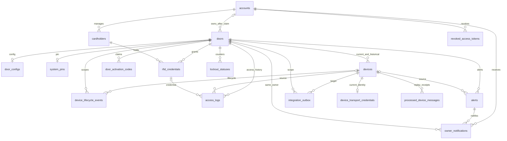

# Database ERD

Bản hiện tại dùng **Flyway V1–V6**, gồm 17 bảng nghiệp vụ và bảng lịch sử Flyway.
`init.sql` vẫn là bootstrap 12 bảng gốc; Backend áp dụng các migration tiếp theo.
Các bảng mới và sơ đồ quan hệ cập nhật nằm tại mục 5 cuối tài liệu. Xem
[bàn giao Người 1, Người 4](../05-backend/person1-person4-completion.md) để chạy
kiểm tra phiên bản và tính toàn vẹn trên database thực tế.

Schema khởi tạo mới cho MySQL 8.4 ở [init.sql](../../infrastructure/mysql/init/init.sql).
[Dữ liệu mẫu](../../infrastructure/mysql/init/mockdata.sql) chỉ dành cho local/demo.
Thiết kế áp dụng [năm quyết định đã chốt](../01-requirements/ownership-device-lifecycle-decisions.md).
Không có bảng users gộp, vai trò ADMIN/USER hoặc bảng vân tay.

Đây là cấu trúc SQL trong repository, chưa xác nhận database đang chạy đã được
nâng cấp. Thay file init không cập nhật volume MySQL cũ. Xem [hướng dẫn database](database-setup.md).
Đã có [JPA entity/repository](../05-backend/entity-repository-mapping.md) cho 12
bảng gốc; V4–V6 bổ sung entity cho 5 bảng phiên, delivery và MQTT. Phần Người 2
có service/API/CLI Door/Device; Người 1 và Người 4 bổ sung JWT thu hồi, credentials,
đồng bộ và cảnh báo. Xem [bàn giao Người 2](../05-backend/door-device-handoff.md)
và [bàn giao Người 1/4](../05-backend/person1-person4-completion.md) để phân biệt
phạm vi đã kiểm chứng. FK không thay thế authorization ở Backend.

## 1. Nguyên tắc

- Account có 0..N Door; Door chưa claim không có chủ, sau claim có đúng một chủ.
- Account và Cardholder tách biệt. RFID thuộc Door và Cardholder cùng khách hàng.
- Cấu hình, PIN, lockout, thiết bị, log và cảnh báo có phạm vi Door.
- Tất cả FK dùng RESTRICT khi xóa để giữ lịch sử; dùng status thay thao tác xóa.
- Thời gian lưu UTC. Online/offline không lưu như lifecycle status.
- PROVISIONED nghĩa là Node đã ghép vào bộ cửa nhưng chưa vận hành.
  Kích hoạt khi đã có chủ và điều kiện cấu hình/credential phù hợp.
- Không có chuyển quyền sở hữu hoặc chuyển Device sang cửa khác trong phạm vi này.
- Giữ operating_mode/AUTO_PROXIMITY và loại cảnh báo cửa mở lâu từ mô hình cũ:
  năm quyết định chưa chốt loại bỏ chúng. Có enum không có nghĩa tính năng hoặc
  cảm biến đã triển khai.

## 2. Giải thích các bảng

### 2.1. `accounts` — Account khách hàng

Tài khoản đăng nhập App; không có role Admin nền tảng.

id: định danh; display_name: tên hiển thị; username: tên đăng nhập unique; password_hash: mật khẩu băm; status: ACTIVE/DISABLED; created_at: lúc tạo.

Các cột trong SQL:

```sql
id BIGINT UNSIGNED NOT NULL AUTO_INCREMENT PRIMARY KEY
display_name VARCHAR(100) NOT NULL
username VARCHAR(100) NOT NULL
password_hash VARCHAR(255) NOT NULL
auth_version BIGINT UNSIGNED NOT NULL DEFAULT 0
status ENUM('ACTIVE','DISABLED') NOT NULL DEFAULT 'ACTIVE'
created_at DATETIME(3) NOT NULL DEFAULT CURRENT_TIMESTAMP(3)
```

### 2.2. `cardholders` — Người giữ thẻ

Hồ sơ người được cấp RFID, không đăng nhập App.

id: định danh; account_id: khách hàng quản lý; display_name: tên; status: ACTIVE/DISABLED; created_at: lúc tạo.

Các cột trong SQL:

```sql
id BIGINT UNSIGNED NOT NULL AUTO_INCREMENT PRIMARY KEY
account_id BIGINT UNSIGNED NOT NULL
display_name VARCHAR(100) NOT NULL
status ENUM('ACTIVE','DISABLED') NOT NULL DEFAULT 'ACTIVE'
created_at DATETIME(3) NOT NULL DEFAULT CURRENT_TIMESTAMP(3)
```

### 2.3. `doors` — Cửa và chủ sở hữu

Một Account sở hữu nhiều cửa. Cửa chưa claim không có chủ.

id: định danh; owner_account_id: FK chủ cửa, NULL trước claim; name/location: tên và vị trí; status: UNCLAIMED/SETUP_PENDING/ACTIVE/DISABLED; operating_mode: chế độ cũ giữ lại vì chưa chốt bỏ khoảng cách/AUTOMATIC; commanded_lock_state: lệnh khóa gần nhất, không phải trạng thái vật lý; created_at/updated_at: thời gian; version: khóa lạc quan.

Các cột trong SQL:

```sql
id BIGINT UNSIGNED NOT NULL AUTO_INCREMENT PRIMARY KEY
owner_account_id BIGINT UNSIGNED NULL
name VARCHAR(100) NOT NULL
location VARCHAR(255) NULL
status ENUM('UNCLAIMED','SETUP_PENDING','ACTIVE','DISABLED') NOT NULL DEFAULT 'UNCLAIMED'
operating_mode ENUM('AUTOMATIC','SECURITY') NOT NULL DEFAULT 'SECURITY'
commanded_lock_state ENUM('LOCKED','UNLOCKED') NULL
created_at DATETIME(3) NOT NULL DEFAULT CURRENT_TIMESTAMP(3)
updated_at DATETIME(3) NOT NULL DEFAULT CURRENT_TIMESTAMP(3) ON UPDATE CURRENT_TIMESTAMP(3)
version BIGINT UNSIGNED NOT NULL DEFAULT 0
```

### 2.4. `door_configs` — Cấu hình cửa

Tối đa một cấu hình mỗi cửa; Backend provision phải tạo đủ cấu hình.

door_id: PK/FK; max_failed_attempts: mặc định 3; lockout_seconds: mặc định 60; temperature_threshold: mặc định 50°C, cảnh báo khi vượt ngưỡng; open_timeout_seconds: NULL nếu chưa đo được cửa mở; version: phiên bản dương; updated_at: lần cập nhật.

Các cột trong SQL:

```sql
door_id BIGINT UNSIGNED NOT NULL PRIMARY KEY
max_failed_attempts INT UNSIGNED NOT NULL DEFAULT 3
lockout_seconds INT UNSIGNED NOT NULL DEFAULT 60
temperature_threshold DECIMAL(5,2) NOT NULL DEFAULT 50.00
open_timeout_seconds INT UNSIGNED NULL
version BIGINT UNSIGNED NOT NULL DEFAULT 1
credentials_version BIGINT UNSIGNED NOT NULL DEFAULT 1
updated_at DATETIME(3) NOT NULL DEFAULT CURRENT_TIMESTAMP(3) ON UPDATE CURRENT_TIMESTAMP(3)
```

### 2.5. `system_pins` — PIN chung theo cửa

Tối đa một PIN hiện hành mỗi cửa; mật khẩu Account khác PIN.

door_id: PK/FK; pin_hash: PIN đã băm; status: ACTIVE/DISABLED; version: phiên bản dương, tăng khi đổi; changed_at: lần đổi. Chưa có trường lưu PIN rõ hoặc lịch sử hash cũ.

Các cột trong SQL:

```sql
door_id BIGINT UNSIGNED NOT NULL PRIMARY KEY
pin_hash VARCHAR(255) NOT NULL
status ENUM('ACTIVE','DISABLED') NOT NULL DEFAULT 'ACTIVE'
version BIGINT UNSIGNED NOT NULL DEFAULT 1
changed_at DATETIME(3) NOT NULL DEFAULT CURRENT_TIMESTAMP(3)
```

### 2.6. `devices` — ESP32 và vòng đời

Thiết bị được provision vào một bộ cửa; thay Node tạo bản ghi mới, giữ bản cũ. Trong phiên bản này không chuyển thiết bị sang Door khác.

id/device_code: định danh nội bộ/công khai unique; door_id: cửa; node_type: NODE_1/NODE_2; lifecycle_status: PROVISIONED/ACTIVE/DISABLED/RETIRED; active_node_type: cột sinh, không ghi trực tiếp; firmware_version: phiên bản; last_heartbeat_at: thời điểm Backend nhận; applied_config_version/applied_pin_version: ACK phiên bản đã áp dụng, NULL nếu chưa biết; registered_at/activated_at/retired_at: mốc vòng đời; version: khóa lạc quan.

Các cột trong SQL:

```sql
id BIGINT UNSIGNED NOT NULL AUTO_INCREMENT PRIMARY KEY
door_id BIGINT UNSIGNED NOT NULL
device_code VARCHAR(100) NOT NULL
node_type ENUM('NODE_1','NODE_2') NOT NULL
lifecycle_status ENUM('PROVISIONED','ACTIVE','DISABLED','RETIRED') NOT NULL DEFAULT 'PROVISIONED'
active_node_type VARCHAR(6) GENERATED ALWAYS AS (CASE WHEN lifecycle_status = 'ACTIVE' THEN node_type ELSE NULL END) STORED
firmware_version VARCHAR(50) NULL
last_heartbeat_at DATETIME(3) NULL
applied_config_version BIGINT UNSIGNED NULL
applied_pin_version BIGINT UNSIGNED NULL
registered_at DATETIME(3) NOT NULL DEFAULT CURRENT_TIMESTAMP(3)
activated_at DATETIME(3) NULL
retired_at DATETIME(3) NULL
version BIGINT UNSIGNED NOT NULL DEFAULT 0
```

### 2.7. `door_activation_codes` — Mã claim bộ cửa

Bằng chứng kích hoạt dùng một lần; device_code không phải bí mật.

id/door_id: định danh và bộ cửa; code_hash: hash bí mật; created_at/expires_at: phát hành/hết hạn; consumed_at/consumed_by_account_id: dấu vết sử dụng, cùng NULL hoặc cùng có giá trị; revoked_at: thu hồi. Không seed mã thật; CLI Người 2 cấp mã mới, API claim có rate limit Account/IP.

Các cột trong SQL:

```sql
id BIGINT UNSIGNED NOT NULL AUTO_INCREMENT PRIMARY KEY
door_id BIGINT UNSIGNED NOT NULL
code_hash VARCHAR(255) NOT NULL
expires_at DATETIME(3) NOT NULL
created_at DATETIME(3) NOT NULL DEFAULT CURRENT_TIMESTAMP(3)
consumed_at DATETIME(3) NULL
consumed_by_account_id BIGINT UNSIGNED NULL
revoked_at DATETIME(3) NULL
```

### 2.8. `device_lifecycle_events` — Lịch sử vòng đời thiết bị

Audit nghiệp vụ, tách khỏi access log và application log.

id/event_id: định danh, event_id unique chống trùng; device_id/door_id: thiết bị đúng cửa; actor_account_id: chủ thực hiện, NULL cho quy trình kỹ thuật; event_type: PROVISIONED/ACTIVATED/DISABLED/REACTIVATED/RETIRED/REPLACED; from_status/to_status: trước/sau; replacement_device_id: thiết bị mới cùng cửa; reason: lý do; occurred_at: thời điểm Backend ghi. Backend ghi cùng transaction với thay đổi Device.

Các cột trong SQL:

```sql
id BIGINT UNSIGNED NOT NULL AUTO_INCREMENT PRIMARY KEY
event_id VARCHAR(100) NOT NULL
device_id BIGINT UNSIGNED NOT NULL
door_id BIGINT UNSIGNED NOT NULL
actor_account_id BIGINT UNSIGNED NULL
event_type ENUM('PROVISIONED','ACTIVATED','DISABLED','REACTIVATED','RETIRED','REPLACED') NOT NULL
from_status ENUM('PROVISIONED','ACTIVE','DISABLED','RETIRED') NULL
to_status ENUM('PROVISIONED','ACTIVE','DISABLED','RETIRED') NOT NULL
replacement_device_id BIGINT UNSIGNED NULL
reason VARCHAR(500) NULL
occurred_at DATETIME(3) NOT NULL DEFAULT CURRENT_TIMESTAMP(3)
```

### 2.9. `rfid_credentials` — RFID theo cửa và người giữ

Cùng UID được đăng ký độc lập tại nhiều cửa.

id: định danh; door_id: cửa; account_id: phạm vi khách hàng, có chủ đích lặp để FK ghép bảo vệ ownership; cardholder_id: người giữ cùng khách hàng; uid_lookup_value: giá trị tra cứu unique theo cửa; status: ACTIVE/REVOKED/EXPIRED; issued_at/revoked_at/expires_at: cấp/thu hồi/hết hạn. Cách bảo vệ UID cần chốt, seed chỉ dùng giá trị giả.

Các cột trong SQL:

```sql
id BIGINT UNSIGNED NOT NULL AUTO_INCREMENT PRIMARY KEY
door_id BIGINT UNSIGNED NOT NULL
account_id BIGINT UNSIGNED NOT NULL
cardholder_id BIGINT UNSIGNED NOT NULL
uid_lookup_value VARCHAR(128) NOT NULL
status ENUM('ACTIVE','REVOKED','EXPIRED') NOT NULL DEFAULT 'ACTIVE'
issued_at DATETIME(3) NOT NULL DEFAULT CURRENT_TIMESTAMP(3)
revoked_at DATETIME(3) NULL
expires_at DATETIME(3) NULL
```

### 2.10. `access_logs` — Lịch sử truy cập và thực thi

Một lần thử có thể có nhiều sự kiện: quyết định xác thực và phản hồi thực thi.

id/event_id: định danh, event_id unique; correlation_id: ghép sự kiện cùng lượt, không unique; door_id: cửa; actor_account_id: chủ yêu cầu từ App, NULL cho RFID/PIN/Exit/nhiệt độ; rfid_credential_id/source_device_id: nguồn nhận diện, đúng cửa, có thể NULL; method: RFID/PIN/APP/EXIT_BUTTON/AUTO_PROXIMITY/FIRE_EMERGENCY; result: GRANTED/DENIED/EXECUTED/FAILED/UNKNOWN; reason: lý do không chứa bí mật; occurred_at: giờ nguồn có thể NULL; received_at: giờ Backend nhận. GRANTED không chứng minh cửa đã mở.

Các cột trong SQL:

```sql
id BIGINT UNSIGNED NOT NULL AUTO_INCREMENT PRIMARY KEY
event_id VARCHAR(100) NOT NULL
correlation_id VARCHAR(100) NULL
door_id BIGINT UNSIGNED NOT NULL
actor_account_id BIGINT UNSIGNED NULL
rfid_credential_id BIGINT UNSIGNED NULL
source_device_id BIGINT UNSIGNED NULL
method ENUM('RFID','PIN','APP','EXIT_BUTTON','AUTO_PROXIMITY','FIRE_EMERGENCY') NOT NULL
result ENUM('GRANTED','DENIED','EXECUTED','FAILED','UNKNOWN') NOT NULL
reason VARCHAR(500) NULL
occurred_at DATETIME(3) NULL
received_at DATETIME(3) NOT NULL DEFAULT CURRENT_TIMESTAMP(3)
```

### 2.11. `lockout_statuses` — Bộ đếm sai

Mỗi cửa có bộ đếm RFID và PIN độc lập.

door_id/method: PK ghép; failed_count: số lần sai không âm; locked_until: hạn khóa hoặc NULL; updated_at: lần cập nhật. Provision tạo hai dòng; Backend quản lý nguồn có thẩm quyền và cập nhật nguyên tử.

Các cột trong SQL:

```sql
door_id BIGINT UNSIGNED NOT NULL
method ENUM('RFID','PIN') NOT NULL
failed_count INT UNSIGNED NOT NULL DEFAULT 0
locked_until DATETIME(3) NULL
updated_at DATETIME(3) NOT NULL DEFAULT CURRENT_TIMESTAMP(3) ON UPDATE CURRENT_TIMESTAMP(3)
```

### 2.12. `alerts` — Cảnh báo theo cửa

Chỉ chủ cửa được xem và nhận thông báo.

id/door_id: định danh và cửa; source_device_id: Node cùng cửa hoặc NULL; type: TOO_MANY_FAILURES/HIGH_TEMPERATURE/DOOR_OPEN_TOO_LONG; severity: WARNING/CRITICAL; status: ACTIVE/ACKNOWLEDGED/RESOLVED; observed_temperature: nhiệt độ tại cảnh báo, không lưu mọi mẫu; triggered_at/resolved_at: phát sinh/kết thúc. ACKNOWLEDGED không đồng nghĩa đã an toàn.

Các cột trong SQL:

```sql
id BIGINT UNSIGNED NOT NULL AUTO_INCREMENT PRIMARY KEY
event_id VARCHAR(100) NULL -- UNIQUE từ migration V3
door_id BIGINT UNSIGNED NOT NULL
source_device_id BIGINT UNSIGNED NULL
type ENUM('TOO_MANY_FAILURES','HIGH_TEMPERATURE','DOOR_OPEN_TOO_LONG') NOT NULL
severity ENUM('WARNING','CRITICAL') NOT NULL
status ENUM('ACTIVE','ACKNOWLEDGED','RESOLVED') NOT NULL DEFAULT 'ACTIVE'
observed_temperature DECIMAL(5,2) NULL
triggered_at DATETIME(3) NOT NULL DEFAULT CURRENT_TIMESTAMP(3)
resolved_at DATETIME(3) NULL
```

## 3. Quan hệ và ràng buộc

| Quan hệ | Bội số | Bảo vệ trong SQL |
| --- | --- | --- |
| Account–Door | 1–N; Door trước claim có 0 chủ | owner_account_id FK; CHECK trạng thái/chủ |
| Account–Cardholder | 1–N | account_id FK |
| Door–RFID–Cardholder | Mỗi RFID một Door/một Cardholder | Hai FK ghép cùng account_id |
| Door–Config/PIN | 1–0..1 tại SQL | door_id PK/FK; Backend tạo đủ trước vận hành |
| Door–Device | 1–N gồm Node đã thay | FK; unique (door_id, active_node_type) |
| Device–Lifecycle event | 1–N | FK ghép Device/Door, replacement cùng Door |
| Door–Activation code | 1–N lịch sử phát hành | FK, thời hạn, cặp trường consumed |
| Door–Access log/Alert | 1–N | FK Door; Node/credential đúng Door qua FK ghép |
| Door–Lockout | Tối đa hai dòng | PK (door_id, method) |

active_node_type chỉ có giá trị khi Device ACTIVE. MySQL cho phép nhiều NULL
trong UNIQUE nên giữ được nhiều Node cũ PROVISIONED/DISABLED/RETIRED nhưng không
cho hai Node ACTIVE cùng vai trò trên cùng cửa.

## 4. Quy tắc nghiệp vụ Backend

Door/Device đã nối JWT, ACK và danh tính MQTT cho kênh cấu hình/cảnh báo. Riêng
workflow thay Node tự động vẫn cần bằng chứng thu hồi quyền Broker cũ. Xem
[bàn giao Người 1/4](../05-backend/person1-person4-completion.md) và
[bàn giao Người 2](../05-backend/door-device-handoff.md) để biết giới hạn xác minh.

1. Claim khóa hàng Door và mã kích hoạt trong transaction, kiểm tra hash,
   hết hạn/thu hồi/đã dùng; ghi chủ và consumed đồng thời. Retry cùng Account
   trả kết quả nhất quán. Không nhận sở hữu bằng device_code.
2. Khi chuyển Door ACTIVE, kiểm tra có chủ, cấu hình, PIN và đúng hai Node hợp
   lệ. FK/CHECK không tự bảo đảm đủ hai Node hoặc ACK cấu hình.
3. Lifecycle: PROVISIONED → ACTIVE; ACTIVE → DISABLED hoặc RETIRED;
   DISABLED → ACTIVE hoặc RETIRED. RETIRED kết thúc. Reactivate phải kiểm tra
   slot và điều kiện an toàn. Claim không tự đổi lifecycle hay mở khóa.
4. Thay Node: retire Node cũ, activate Node mới cùng cửa/vai trò và ghi event
   trong transaction; cấp/thu hồi Broker credential cần workflow retry riêng.
   Database commit không tự thu hồi quyền MQTT.
5. Giữ device_code, Door và node_type ổn định; lịch sử và credential đã có log
   không đổi Cardholder để tránh viết lại danh tính lịch sử.
6. Mọi request xác định Account từ JWT và kiểm tra owner. NULL actor cho quy
   trình kỹ thuật không phải đường bỏ qua kiểm tra quyền ở API.
7. Cardholder DISABLED phải bị từ chối, thu hồi RFID cùng transaction; kích
   hoạt lại không tự khôi phục thẻ. Policy Account DISABLED/offline còn cần
   đặc tả, không suy ra từ Cardholder.
8. Online nếu heartbeat chưa quá timeout; offline nếu quá hạn; UNKNOWN nếu
   chưa nhận. Timeout cần chốt theo firmware. Dùng thời gian Backend nhận.
9. applied_*_version chỉ cập nhật khi nhận ACK đáng tin cậy; lưu thành công
   server chưa chứng minh Node đã áp dụng. PIN/RFID dùng chung
   `door_configs.credentials_version`; `devices.applied_pin_version` lưu ACK
   phiên bản credentials của Node 1 vì giữ tên cột cũ để tương thích migration.
10. Không ghi password/PIN/mã kích hoạt/credential MQTT vào log.
    event_id ổn định để retry không tạo log/event trùng.

## 5. Bổ sung sau migration V3–V6

Phần mô tả 12 bảng trên bắt nguồn từ bootstrap V1. Bản đang chạy sau nâng cấp có:

| Đối tượng | Thuộc tính/ràng buộc bổ sung | Ý nghĩa |
| --- | --- | --- |
| `accounts` | `auth_version BIGINT UNSIGNED NOT NULL DEFAULT 0` | Tăng khi đổi mật khẩu, vô hiệu hóa JWT cũ |
| `door_configs` | `credentials_version BIGINT UNSIGNED NOT NULL DEFAULT 1` | Phiên bản snapshot PIN/RFID chung của Node 1 |
| `alerts` | `event_id VARCHAR(100) NULL UNIQUE`; unique `(id,door_id)` | Retry cảnh báo mới không ghi trùng; alert cũ được giữ nguyên |
| `revoked_access_tokens` | PK `token_id`; FK `account_id`; `expires_at`, `revoked_at` | Thu hồi một JWT đến hết thời hạn; không lưu bearer token |
| `integration_outbox` | PK `id`; FK Door, FK ghép `(device_id,door_id)`; `kind`, `device_code`, `payload`, `status`, `attempts`, `next_attempt_at`, `lease_until`, `lease_token`, `last_error`, `created_at`, `sent_at`, `version` | Giao cấu hình/credentials bền vững; lease tránh hai worker cùng gửi một claim |
| `owner_notifications` | PK `id`; FK Account, FK ghép Alert/Door và Door/chủ; unique `(alert_id,account_id)`; `title`, `body`, `created_at`, `read_at` | Một thông báo cho đúng chủ cửa, đọc độc lập với xử lý cảnh báo |
| `device_transport_credentials` | PK/FK `device_id`; unique `credential_id`; `verified_at`, `revoked_at`, `created_at` | Danh tính kỹ thuật đang có của mỗi Node, không chứa secret rõ |
| `processed_device_messages` | PK `id` SHA-256; FK `device_id`; `received_at` có index | Chống xử lý lại nonce của thông điệp ký HMAC; dọn receipt quá hạn |



Cardinality trong sơ đồ phản ánh SQL (ví dụ Config/PIN có thể chưa có trước khi
service hoàn tất setup). Service vẫn kiểm tra đủ cấu hình/PIN/hai Node trước
khi vận hành. FK ghép bảo đảm RFID đúng Account, outbox đúng Door/Node và inbox
đúng chủ cửa; sơ đồ rút gọn không thay thế toàn bộ CHECK/UNIQUE trong migration.

Kiểm tra database thật bằng `python scripts/db-check.py --expect-version 6`.
Các dòng `PASS` phản ánh các bất biến được truy vấn; không xác nhận chất lượng
nguồn điện, cảm biến hoặc kết quả đóng/mở khóa trên phần cứng.

## 5. Dữ liệu mẫu và kiểm chứng

Seed có ba Account (một Account chưa có cửa), bốn Door (A có hai, B có một,
một bộ chưa claim), Cardholder riêng khách hàng, cùng UID tại nhiều cửa, Node
ACTIVE/mất heartbeat/chưa từng liên lạc và Node RETIRED đã thay.
Các ID và hash là fixture demo; không đại diện tài khoản, credential hoặc kết
nối phần cứng thật. Không seed mã kích hoạt/MQTT secret. Trạng thái heartbeat
chỉ là snapshot tại thời điểm seed.

[verify.sql](../../infrastructure/mysql/verify.sql) kiểm tra dữ liệu mẫu, từ chối
RFID chéo khách hàng, Node ACTIVE trùng slot, log nguồn sai cửa, claim sai
trạng thái và event trùng. Chỉ chạy trên database thử nghiệm.
