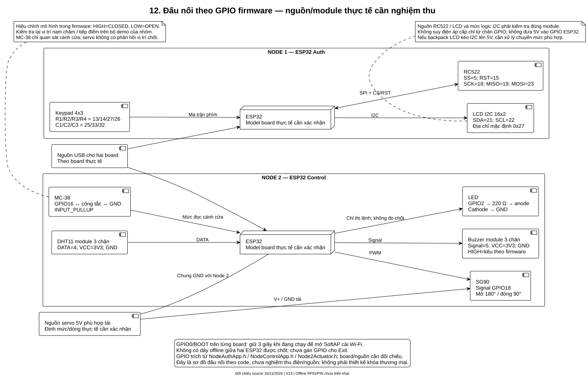

# Đấu nối phần cứng theo firmware hiện tại

Bảng này đối chiếu source ngày 15/11/2026. Chân là GPIO trên ESP32, không phải
số thứ tự chân trên mọi board. Model board, nguồn và dây thực tế còn phải xác
nhận khi lắp bộ demo. Không coi bảng là biên bản đã nghiệm thu phần cứng.

[Source PlantUML](diagrams/12-hardware-wiring.puml).

## Node 1 — RFID, keypad và LCD

| Ngoại vi | Chân theo code |
| --- | --- |
| RC522 SPI | SS 5, RST 15, SCK 18, MISO 19, MOSI 23 |
| Keypad 4x3 hàng R1–R4 | 13, 14, 27, 26 |
| Keypad cột C1–C3 | 25, 33, 32 |
| LCD I2C 16x2 | SDA 21, SCL 22, địa chỉ mặc định 0x27 |
| BOOT | GPIO0 trên board, giữ 3 giây khi chạy để mở cài Wi-Fi |

Nguồn RC522 và nguồn/mức logic LCD backpack phải kiểm tra theo module thực
tế. Không đưa tín hiệu 5V vào GPIO ESP32; backpack kéo I2C lên 5V cần xử lý
chuyển mức phù hợp. Không thay LCD bằng OLED mà giữ nguyên driver hiện tại.

## Node 2 — điều khiển và cảm biến

| Ngoại vi | Chân / hành vi theo code |
| --- | --- |
| SG90 | Signal 18; mở 180°, đóng 90°; nguồn servo 5V phù hợp tải |
| MC-38 | GPIO16 và GND, INPUT_PULLUP; hiệu chỉnh hiện tại HIGH=CLOSED, LOW=OPEN |
| DHT11 module 3 chân | DATA 4, VCC 3V3, GND |
| Buzzer module 3 chân | Signal 5, VCC 3V3, GND; HIGH=kêu |
| LED | GPIO2 qua điện trở 220 Ω đến anode, cathode GND |
| BOOT | GPIO0 trên board, giữ 3 giây khi chạy để mở cài Wi-Fi |
| Nút Exit | Chưa đấu/chưa gán GPIO trong bản tích hợp |
| Dây/kênh offline đến Node 1 | Chưa chốt; không tự thêm UART/ESP-NOW |

Nguồn servo nối chung GND với Node 2. Cần xác nhận nguồn, dòng tải và cơ khí
trước vận hành. ACK của SG90 không đo vị trí servo/chốt; MC-38 đo cánh cửa.
Hai board trần chưa chứng minh được tác động mở/đóng vật lý.

## Căn cứ và các bước nghiệm thu còn lại

- [NodeAuthApp.h](../../firmware/node-auth/NodeAuthApp.h),
  [README Node 1](../../firmware/node-auth/README.md).
- [NodeControlApp.h](../../firmware/node-control/NodeControlApp.h),
  [Node2Actuator.h](../../firmware/node-control/Node2Actuator.h),
  [README Node 2](../../firmware/node-control/README.md).
- [Cài Wi-Fi và bàn giao](../05-backend/device-onboarding.md).

Ghi model board/module thật, nguồn và dây đã dùng; kiểm tra GPIO từng nhánh,
chiều servo/tiếp điểm MC-38, cấp nguồn và reset, rồi thử trọn luồng onboarding
trên hai ESP32. Firmware đã build không thay kết quả thử phần cứng thật.
