# Hồ sơ thiết kế hệ thống Smart Door

Bộ sơ đồ này được đối chiếu source trong workspace ngày **15/11/2026**, gồm
schema V13, App theo vai trò CUSTOMER/TECHNICIAN, đăng ký ESP32, bàn giao cửa,
SoftAP cài Wi-Fi và firmware tích hợp hai Node. Tài liệu đi cùng thay đổi
onboarding V13 trong PR, thay cho mốc thiết kế V10 trước đây.

**Nhóm vẫn làm offline; sơ đồ 6 tạm hoãn theo yêu cầu.** Node 2 có một số
thao tác tại chỗ, nhưng xác thực RFID/PIN và mở khóa offline giữa hai Node
chưa hoàn thiện. Không tự chọn ESP-NOW, UART hoặc giao thức khác thay nhóm.

Thiết kế theo code không phải biên bản nghiệm thu phần cứng. Bản onboarding
đã được thử bằng giả lập; SoftAP, camera, nguồn và cơ khí cần thử trên bo thật.
Xem [hướng dẫn bàn giao và chạy thử](../05-backend/device-onboarding.md).

## Mục lục và mức hoàn thiện

| Số | Sơ đồ | Hiện trạng tài liệu |
| --- | --- | --- |
| [1](#diagram-01) | Kiến trúc tổng thể | Cập nhật V13, role, SoftAP, bootstrap và manifest Broker |
| [2](#diagram-02) | Khối phần cứng | Khớp LCD/RC522/keypad và SG90/DHT11/MC-38; nguồn cần xác nhận |
| [3](#diagram-03) | Miền và sở hữu | Thêm InventoryUnit, InstallationKit và role; tách kỹ thuật viên khỏi chủ cửa |
| [4](#diagram-04) | RFID/PIN online | Quyết định, khóa tạm, AUTOMATIC, điều khiển servo và telemetry |
| [5](#diagram-05) | Điều khiển từ App | UNLOCK/CLOSE, ACK, timeout, điều kiện từ chối và trạng thái quan sát |
| 6 | Cảnh báo và mất kết nối | **Tạm hoãn; không nhúng hoặc phát hành bản cũ** |
| [7](#diagram-07) | ERD đầy đủ và rút gọn | Cùng V13: 21 bảng nghiệp vụ, 35 FK; đầy đủ có lịch sử Flyway |
| [8](#diagram-08) | Đăng ký, provision, claim và kích hoạt | Thay CLI trong luồng chính bằng App; có sơ đồ 8b cài Wi-Fi chi tiết |
| [9](#diagram-09) | Trạng thái thiết bị | Lifecycle, kết nối và trạng thái Door riêng; thay Node có điều kiện V12 |
| [10](#diagram-10) | MQTT và ACL | Có CLOSE, retained/QoS, danh tính riêng và manifest tự cập nhật |
| [11](#diagram-11) | Triển khai | Docker/volume/cổng, USB debug và đường LAN riêng của ESP32 |
| [12](#diagram-12) | Đấu nối | GPIO theo firmware; còn phải xác nhận board, nguồn và dây thực tế |

Có **11 nhóm đã cập nhật**, gồm **13 cặp `.puml`/`.svg`** do nhóm 7 có hai bản
ERD và nhóm 8 có thêm sơ đồ Wi-Fi. Sơ đồ 6 nằm ngoài danh sách phát hành.
Source PlantUML là bản chính; SVG sinh từ source để xem trực tiếp trên GitHub.

## Thay đổi so với bộ sơ đồ cũ

- Luồng chính không yêu cầu kỹ thuật viên sửa DB hoặc chạy CLI để tạo bộ cửa.
  App gọi API có phân quyền để đăng ký kho, tạo bộ cửa và cấp mã bàn giao.
- Đăng ký Node chỉ tạo danh tính trên hệ thống, không nạp chương trình vào bo.
  Xưởng vẫn nạp firmware/header riêng qua USB; kỹ thuật viên lắp đặt dùng App
  với bo đã chuẩn bị. QR là tem danh tính, không phải công cụ nạp firmware.
- Mã Node/setup thuộc từng ESP32; mã claim thuộc Door. Mọi nơi quét QR có
  đường nhập tay. Chủ nhà claim trước, sau đó ESP32 mới được enrollment.
- ESP32 nhận Door ID và MQTT identity từ Backend sau claim. Wi-Fi nhà được
  gửi trực tiếp từ điện thoại đến từng SoftAP, không nhập vào DB/Backend.
- Khối phần cứng và đấu nối chuyển từ OLED/relay tham chiếu sang LCD/servo
  của firmware hiện tại. Exit vẫn được ghi là chưa đấu/tích hợp.
- ERD rút gọn lên V13, bỏ số bảng/FK cũ. Lifecycle bổ sung complete-setup
  nguyên tử và bằng chứng thu hồi Broker, không vẽ chuyển bo sang Door khác
  như chức năng đã có.

<a id="diagram-01"></a>
## 1. Kiến trúc tổng thể

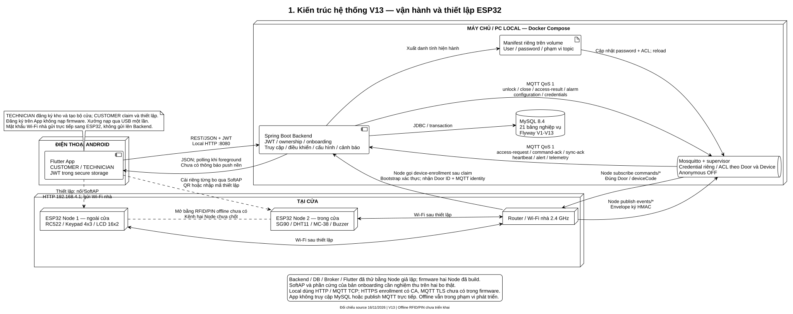

[Source](diagrams/01-system-overview.puml).

Flutter gọi REST với JWT; Backend xử lý nghiệp vụ, JDBC/MySQL và MQTT.
TECHNICIAN có kho/bộ cửa riêng; CUSTOMER claim, thiết lập và điều khiển cửa
của mình. App không truy cập DB/MQTT trực tiếp. Thông báo hiện dùng inbox và
polling foreground, chưa có FCM.

SoftAP là đường cài đặt tạm giữa điện thoại và từng ESP32. Sau khi có Wi-Fi
nhà, ESP32 gọi enrollment qua mạng đến server rồi dùng MQTT với credential
riêng. Địa chỉ bootstrap phải truy cập được từ nơi đặt bo. Supervisor nhận
manifest riêng trên volume để cập nhật user/password/ACL của Broker.

<a id="diagram-02"></a>
## 2. Khối phần cứng hai Node

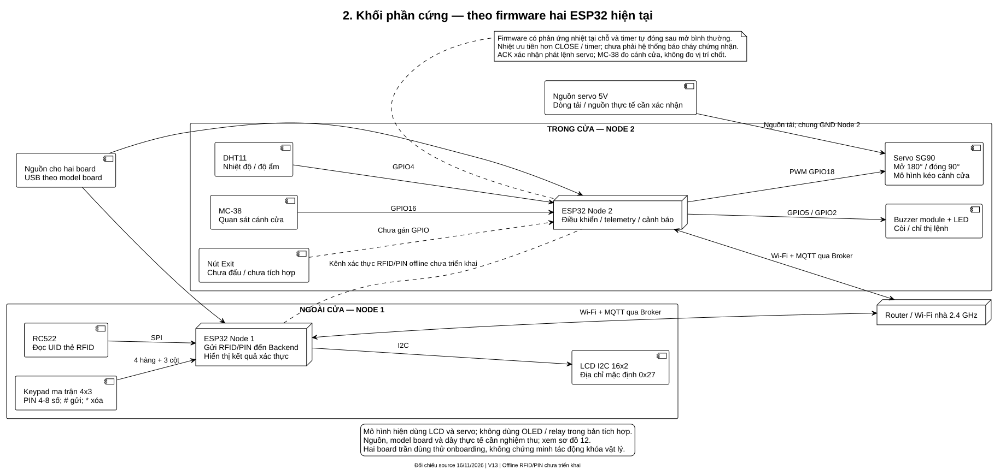

[Source](diagrams/02-hardware-blocks.puml).

Node 1 có **RC522, keypad 4x3, LCD I2C 16x2**. Node 2 có **servo SG90,
DHT11, MC-38, buzzer và LED**. Servo điều khiển mô hình cánh cửa; không vẽ
relay/khóa điện như phần cứng đã tích hợp. Exit chưa có GPIO/luồng tích hợp.

Node 2 có timer đóng sau mở bình thường và phản ứng nhiệt tại chỗ. Điều này
không chứng minh RFID/PIN offline giữa hai Node đã hoạt động. Nguồn, board và
cơ khí phải đối chiếu bộ demo thật; xem sơ đồ 12.

<a id="diagram-03"></a>
## 3. Mô hình miền và sở hữu

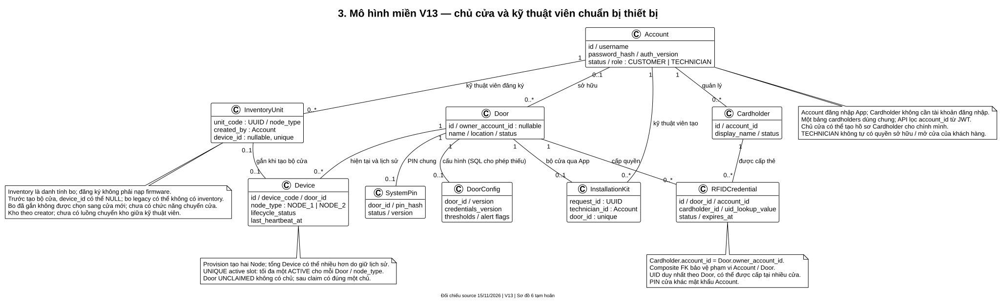

[Source](diagrams/03-domain-ownership.puml).

Account đăng nhập và sở hữu Door; Cardholder là hồ sơ người được cấp quyền,
không bắt buộc có tài khoản đăng nhập. RFID được cấp theo từng Door của cùng
Account. API lấy accountId từ JWT và lọc theo chủ, dù DB dùng chung bảng.

InventoryUnit là danh tính bo do kỹ thuật viên đăng ký. Khi tạo bộ cửa, nó
mới liên kết với Device thuộc Door. InstallationKit lưu kỹ thuật viên và
requestId để retry. Role kỹ thuật viên không cấp quyền mở cửa khách hàng.
Kho đang theo creator; chưa có luồng chuyển kho giữa kỹ thuật viên hoặc
chuyển một bo đã gắn sang Door khác. Device cũ được giữ để truy lịch sử.

<a id="diagram-04"></a>
## 4. Xác thực RFID/PIN online

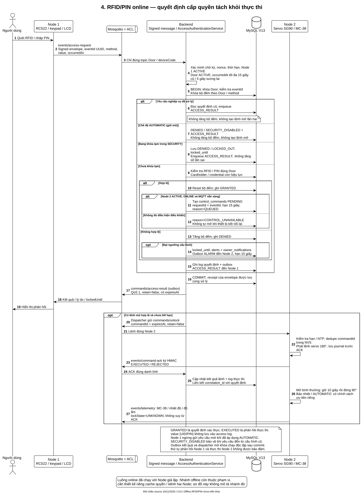

[Source](diagrams/04-rfid-pin-sequence.puml).

Node 1 đọc thông tin, Backend kiểm tra envelope, vai trò, quyền theo Door,
bộ đếm sai và khóa tạm. Đúng quyền ghi GRANTED; chỉ tạo lệnh mở khi Node 2
và transport sẵn sàng. CONTROL_UNAVAILABLE có thể đi cùng quyết định hợp lệ.
eventId trùng không tăng số lần sai hoặc mở lại. Không lưu UID/PIN rõ vào log.

Trong AUTOMATIC (tắt bảo mật/giữ mở), Node 1 ngừng gửi yêu cầu mới; yêu cầu
từ cấu hình cũ nhận SECURITY_DISABLED, không tăng bộ đếm hay kích còi.
GRANTED khác EXECUTED; servo thực thi và telemetry cánh cửa là các bước riêng.

<a id="diagram-05"></a>
## 5. Điều khiển cửa từ App

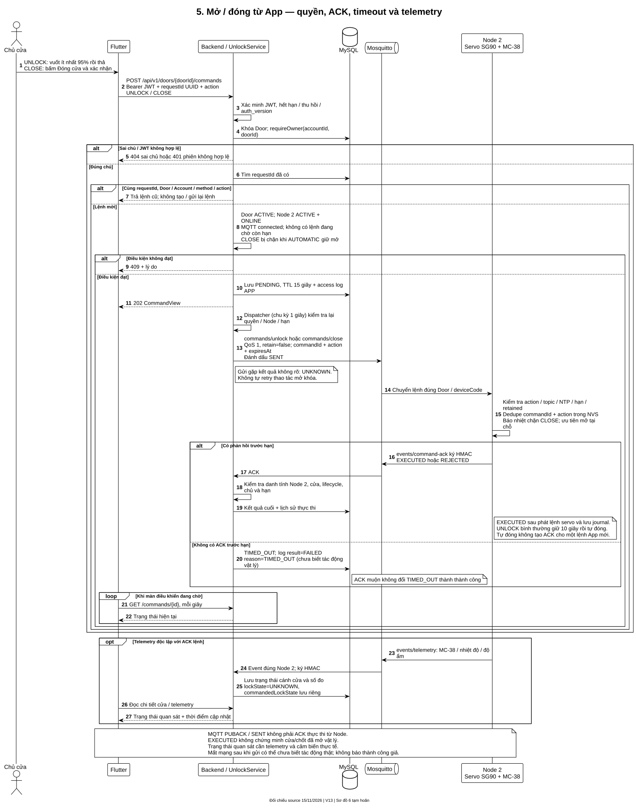

[Source](diagrams/05-app-control-sequence.puml).

Mở cửa bằng vuốt; đóng cửa bằng nút và xác nhận. POST commands nhận UNLOCK
hoặc CLOSE, lấy Account từ JWT và kiểm tra chủ cửa, Door ACTIVE, Node 2
ACTIVE/ONLINE, MQTT sẵn sàng và không có lệnh trước còn chờ. CLOSE bị chặn
trong AUTOMATIC; firmware từ chối CLOSE khi đang báo nhiệt.

UUID requestId chống tạo lệnh lặp; thời hạn 15 giây. Kết quả gửi không rõ là
UNKNOWN, không tự phát lại thao tác; thiếu ACK đúng hạn là TIMED_OUT. ACK muộn
không đổi thành thành công. Node lưu journal trước ACK, mở bình thường giữ
10 giây rồi tự đóng; nhiệt/giữ mở có chính sách riêng.

SENT/PUBACK khác ACK thực thi. EXECUTED/commandedLockState không phải phép đo
vị trí thật; MC-38 đo cánh cửa, còn telemetry lockState là UNKNOWN vì servo
không có cảm biến phản hồi chốt.

## 6. Cảnh báo và mất kết nối — tạm hoãn

Giữ yêu cầu offline nhưng chưa vẽ/phát hành sơ đồ 6 trong đợt này. Node 2 đã
có timer, phản ứng nhiệt và bộ đệm alert hữu hạn trong firmware. Phần còn thiếu
cho mở bằng RFID/PIN offline gồm kênh hai Node, hiệu lực/thu hồi quyền, chống
replay và đối soát. Không lấy bản sơ đồ 6 cũ làm mô tả phần đã triển khai.

<a id="diagram-07"></a>
## 7. ERD V13 đầy đủ và rút gọn

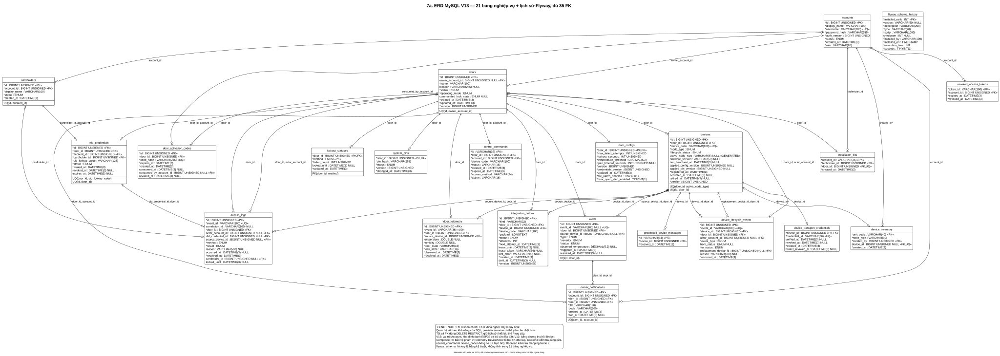

[Source đầy đủ](diagrams/07-database-erd.puml) ·
[SVG để phóng to](diagrams/07-database-erd.svg) ·
[Khóa và CHECK V13](diagrams/database-constraints-v13.md).

Bản đầy đủ giữ metadata MySQL V13 kiểm tra ngày 12/11, đối chiếu migration
hiện tại: **21 bảng nghiệp vụ + flyway_schema_history, 35 FK**, có cột, PK,
unique, nullable và generated column. V13 thêm accounts.role, device_inventory
và installation_kits. Không sửa migration đã áp dụng hoặc đưa dữ liệu người
dùng vào sơ đồ. Một số FK composite giữ phạm vi Account/Door/Device.

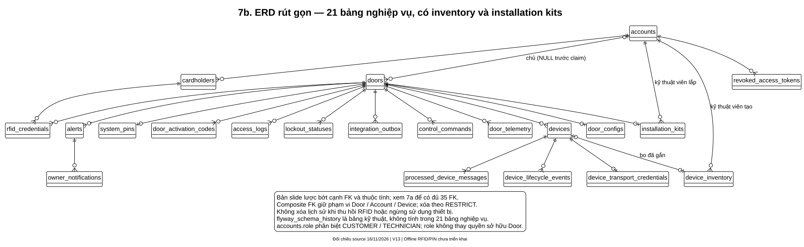

[Source rút gọn](diagrams/07-database-erd-slide.puml).

Bản slide cùng 21 bảng nghiệp vụ nhưng lược cạnh/cột. Telemetry có hai FK
Door/Device độc lập, Backend kiểm tra cùng cửa; control_commands.device_code
không có FK trực tiếp, Backend đối chiếu Node trước gửi/nhận. Dùng bản đầy đủ,
[đặc tả DB](database-erd.md) và migration khi kiểm tra ràng buộc.

<a id="diagram-08"></a>
## 8. Đăng ký ESP32, tạo bộ cửa, claim và kích hoạt

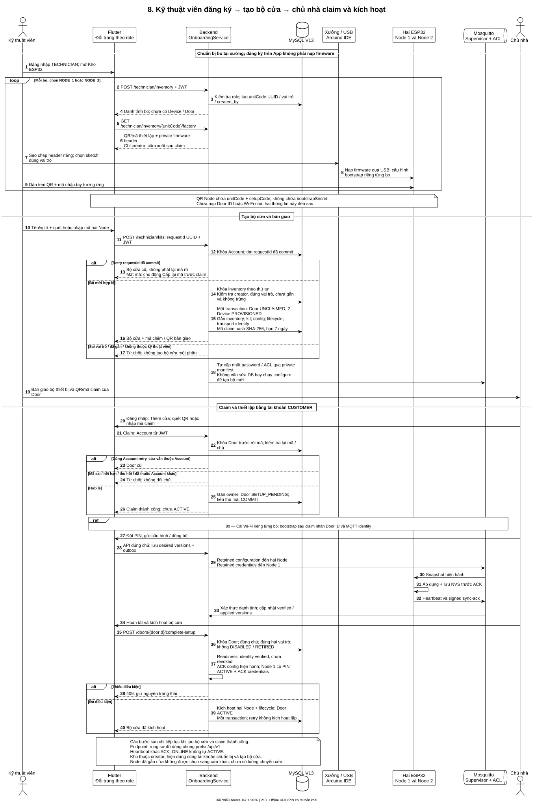

[Source](diagrams/08-provision-claim-sequence.puml).

Kỹ thuật viên đăng ký hai bo trong Kho ESP32, xuất private header và tem,
nạp firmware đúng vai trò qua USB tại xưởng. App đăng ký không tự nạp firmware.
Tem Node chứa unitCode/setupCode; bootstrapSecret chỉ ở file nạp riêng.
Factory export chỉ cho creator và bị chặn sau claim.

Tạo bộ cửa kiểm tra creator, hai vai trò và bo chưa gắn. Khóa inventory ngăn
gắn đồng thời, requestId giữ retry nhất quán. Transaction tạo Door UNCLAIMED,
hai Device PROVISIONED, liên kết inventory, kit và transport credential.
Broker tự nhận user/ACL qua manifest. Mã claim có 8 ký tự, hiển thị dạng
XXXX-XXXX, hạn 7 ngày, DB chỉ lưu SHA-256. Nếu mất phản hồi chứa mã, dùng
Cấp lại mã trước claim, mã cũ hết hiệu lực.

Chủ nhà claim bằng QR hoặc nhập tay. Claim khóa Door trước mã để chỉ một chủ
thành công; retry cùng Account trả Door cũ, không tạo cửa mới. Claim đưa Door
về SETUP_PENDING, chưa tự ACTIVE. Sau Wi-Fi, PIN và ACK phiên bản hiện hành,
complete-setup khóa Door và kích hoạt hai Node trong một transaction.

### 8b. Cài Wi-Fi từng ESP32 và enrollment

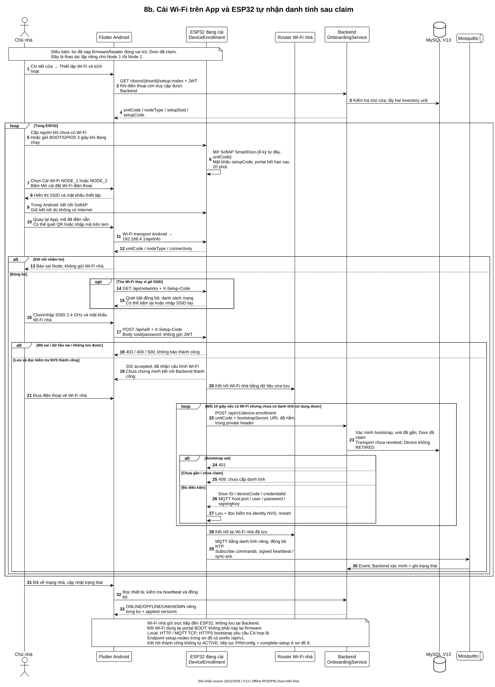

[Source](diagrams/08b-wifi-enrollment-sequence.puml) ·
[API và QR/manual contract](../../contracts/api/device-onboarding.md).

Chủ nhà mở **Thiết lập Wi-Fi và kích hoạt** khi App còn kết nối Backend.
Chọn Node 1, mở cài đặt Wi-Fi Android và nối SoftAP SmartDoor-… với mật khẩu
setup trên App/tem. Chấp nhận mạng không có Internet, quay lại App, quét hoặc
nhập mã, chọn/nhập Wi-Fi nhà 2.4 GHz và bấm **Lưu Wi-Fi vào Node**. App kiểm
tra đúng unitCode/vai trò trước khi gửi. Làm tương tự với Node 2, mỗi lần quay
điện thoại về mạng nhà trước cập nhật trạng thái.

BOOT/GPIO0 giữ 3 giây khi firmware đang chạy mở lại portal; chưa lưu Wi-Fi
thì portal tự mở, hết hạn sau 20 phút. POST local trả 202 chỉ xác nhận lưu
cấu hình, không bảo đảm đã kết nối server. Mật khẩu Wi-Fi ở NVS của bo,
không gửi Backend. Có Wi-Fi thì bo bootstrap bằng khóa riêng, nhận Door ID
và MQTT identity sau claim, lưu rồi restart để kết nối MQTT/NTP và gửi event.

Không nhập IP server ở màn hình Wi-Fi. Bootstrap URL đã nằm trong header;
MQTT host/port đến từ enrollment. Đổi Wi-Fi không cần nạp lại firmware.
Readiness hiện dựa trên identity verified và ACK config/credentials đúng
phiên bản, không bắt buộc heartbeat còn mới; điều khiển từ App có kiểm tra
ONLINE riêng. Node DISABLED cần thao tác lifecycle riêng để dùng lại.

<a id="diagram-09"></a>
## 9. Lifecycle, kết nối và trạng thái Door

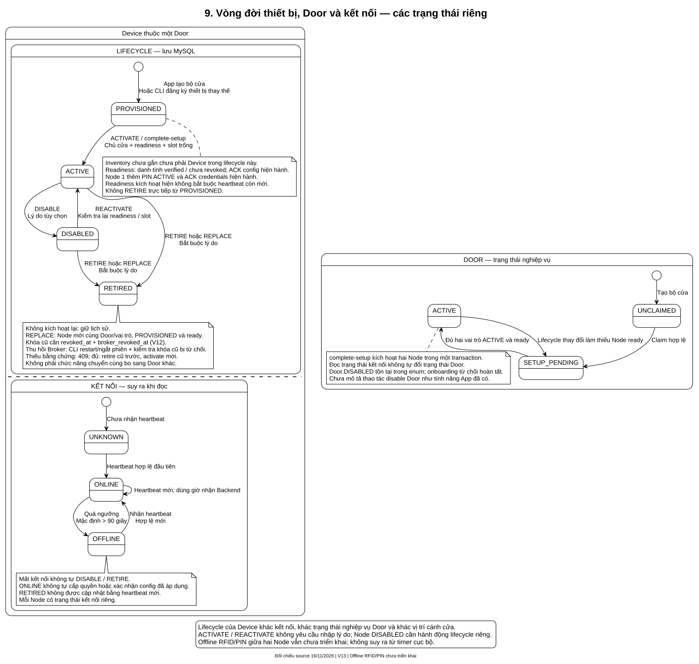

[Source](diagrams/09-device-state.puml).

Device có PROVISIONED, ACTIVE, DISABLED, RETIRED; inventory chưa gắn chưa nằm
trong lifecycle Device. Retire giữ lịch sử và không kích hoạt lại; chưa có
RETIRE trực tiếp từ PROVISIONED. Activate/reactivate không bắt nhập lý do.

Kết nối độc lập: UNKNOWN nếu chưa có heartbeat; ONLINE trong ngưỡng; OFFLINE
khi quá ngưỡng, mặc định hơn 90 giây tính theo giờ nhận Backend. Mất mạng
không tự disable, ONLINE không chứng minh đã áp dụng cấu hình hay đủ quyền.

Thay thiết bị cần Node mới cùng Door/vai trò, sẵn sàng và credential cũ có
revoked_at cùng broker_revoked_at hợp lệ. CLI thu hồi restart/ngắt phiên và
kiểm tra khóa cũ bị từ chối. Reload ACL đơn thuần không chứng minh ngắt phiên.
Đây khác chuyển một bo đang dùng sang Door mới, chức năng đó chưa có trên App.

<a id="diagram-10"></a>
## 10. MQTT và quyền topic

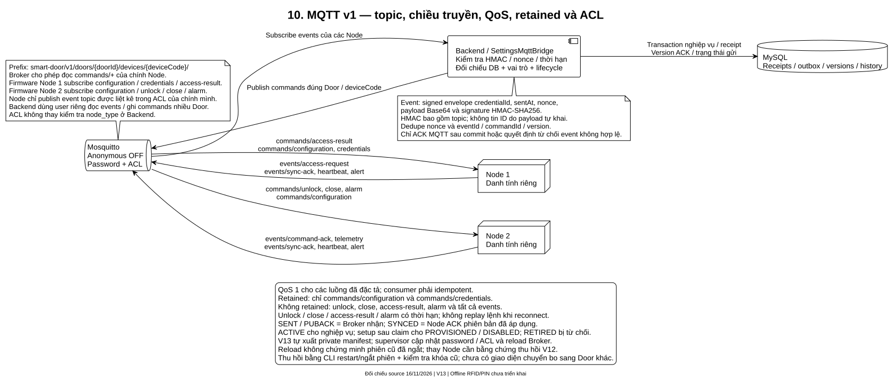

[Source](diagrams/10-mqtt-acl-flow.puml) ·
[Hợp đồng topic/payload](../../contracts/mqtt/topics.md).

Prefix smart-door/v1/doors/{doorId}/devices/{deviceCode}/ ràng buộc danh tính
và cửa. QoS 1; retained chỉ configuration/credentials. UNLOCK, CLOSE,
access-result, alarm và events không retained. Backend kiểm tra HMAC chứa
topic, nonce, thời hạn, mapping DB, vai trò và lifecycle; ACL không thay các
kiểm tra này. Consumer chống lặp bằng nonce/eventId/commandId/version.

V13 tự xuất manifest riêng cho supervisor Broker, không đưa signingKey vào
manifest. Password được hash cho Broker; ACL đổi theo danh tính hiện hành.
Thu hồi phiên cũ vẫn cần workflow V12. Snapshot PIN/thẻ không chứng minh
luồng mở RFID/PIN offline đã triển khai.

<a id="diagram-11"></a>
## 11. Triển khai local

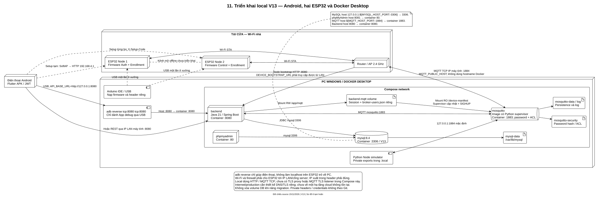

[Source](diagrams/11-deployment.puml).

Compose chạy Backend, MySQL, Mosquitto có supervisor và phpMyAdmin. Host
8080 là Backend, 8081 là phpMyAdmin; MQTT mặc định 1884 → 1883 trong Docker.
MySQL chỉ bind loopback theo MYSQL_HOST_PORT, mặc định 3306 → 3306. Volume
backend-mqtt dùng RW cho Backend và RO cho manifest consumer của Broker.

App debug có thể dùng adb reverse qua USB hoặc IP LAN. ESP32 phải truy cập
IP LAN/server thật, không dùng localhost hoặc hostname mosquitto trong Docker.
Máy tính có dây Ethernet vẫn dùng được nếu router cho thiết bị Wi-Fi đến LAN.
Đổi mạng/IP phải kiểm tra bootstrap URL, MQTT_PUBLIC_HOST, cổng và firewall.
HTTP/MQTT TCP là cấu hình local; triển khai Internet/TLS chưa được coi đã có.

<a id="diagram-12"></a>
## 12. Đấu nối theo firmware

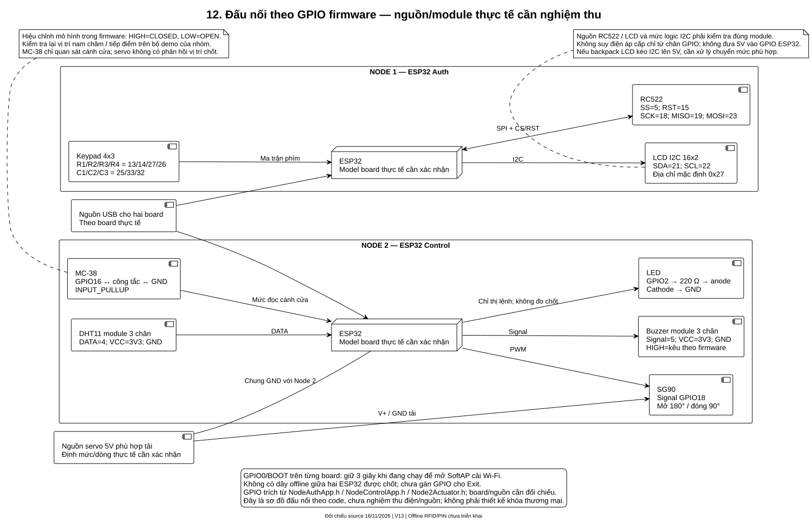

[Source](diagrams/12-hardware-wiring.puml) ·
[Bảng GPIO Node 1](../../firmware/node-auth/README.md) ·
[Bảng GPIO Node 2](../../firmware/node-control/README.md).

Sơ đồ đã điền chân SPI RC522, hàng/cột keypad, I2C LCD, PWM servo, DHT11,
MC-38, buzzer, LED và BOOT. Dùng NodeAuthApp.h, NodeControlApp.h và
Node2Actuator.h làm căn cứ; không để toàn bộ GPIO là TBD như bản cũ.

Phần còn cần xác nhận từ bộ demo gồm model board, nguồn servo 5V và dòng tải,
nguồn/mức logic của RC522 và LCD backpack, vị trí tiếp điểm MC-38 và dây thực
tế. Servo dùng nguồn phù hợp và chung GND với Node 2. Không suy điện áp nguồn
từ số GPIO. Exit và dây offline chưa chốt nên không vẽ chân giả định.
Xem [bảng đấu nối](hardware-wiring.md) để tra và bổ sung kết quả nghiệm thu.

## Kiểm tra và giới hạn

Đợt này chỉ cập nhật tài liệu/sơ đồ, không đổi nghiệp vụ hoặc DB. Kiểm tra
cú pháp toàn bộ PlantUML phát hành, sinh lại SVG, kiểm tra cấu trúc SVG,
đối chiếu cột/cạnh ERD, đường dẫn và xem ảnh các sơ đồ vừa thay đổi lớn.
Kết quả chạy kiểm tra được ghi ở [biên bản sơ đồ](diagrams/design-validation-v13.md).

Các kết quả ứng dụng trước đó được ghi riêng trong
[tài liệu onboarding](../05-backend/device-onboarding.md): backend 193 test
cũ và 5 onboarding, Flutter analyze và 77 test, debug APK, hai firmware build,
migration MySQL V13 và smoke API/MQTT bằng giả lập. Không coi đây là kết quả
chạy lại trong đợt sửa sơ đồ hoặc bằng chứng đã thử Wi-Fi/khóa trên bo thật.

Sinh ảnh từ thư mục gốc bằng PlantUML JAR local, Java 21:

```powershell
$sources = Get-ChildItem docs/03-technical-reference/diagrams/*.puml |
    Where-Object { $_.Name -ne '06-alert-offline-flow.puml' }
java -jar <duong-dan-plantuml.jar> -charset UTF-8 -checkonly $sources.FullName
java -jar <duong-dan-plantuml.jar> -charset UTF-8 -tsvg $sources.FullName
```

Không sửa SVG bằng tay. Không đưa JAR, private header, credential hoặc dữ liệu
khách hàng vào Git. Bản sơ đồ 6 local cũ tiếp tục nằm ngoài nội dung commit.
