# Hồ sơ thiết kế hệ thống Smart Door

Hồ sơ này cập nhật bộ sơ đồ theo source tại commit `253d14e` (bản sửa V10),
đã đưa vào `dev` qua [PR #21](https://github.com/Nozs002/Smart-Door-System/pull/21).
Thay cho bản rà soát 27/10/2026, hồ sơ phản ánh JWT, đồng bộ, MQTT có ACL,
RFID/PIN, lệnh mở khóa, lịch sử và telemetry hiện đã có code.

**Phạm vi mới nhất của nhóm: vẫn làm offline; tạm chưa làm sơ đồ 6.** Luồng
online đủ thông tin được mô tả chi tiết. Kênh offline, cache quyền/PIN, thu hồi,
đồng bộ sau reconnect và hành vi khi reboot chưa được chốt hoặc hiện thực.
Không tự chọn ESP-NOW, dây nối hay cơ chế cache thay nhóm firmware.

## Mục lục và mức hoàn thiện

| Số | Sơ đồ | Mức hoàn thiện |
| --- | --- | --- |
| [1](#diagram-01) | Kiến trúc tổng thể | Hoàn thiện theo hiện trạng phần mềm; firmware/offline có nhãn |
| [2](#diagram-02) | Khối phần cứng | Hoàn thiện phân vai; model linh kiện và nguồn còn TBD |
| [3](#diagram-03) | Miền và quan hệ sở hữu | Hoàn thiện |
| [4](#diagram-04) | RFID/PIN | Hoàn thiện luồng online; offline cần thiết kế riêng |
| [5](#diagram-05) | Điều khiển từ App | Hoàn thiện luồng online, ACK và timeout |
| 6 | Cảnh báo và mất kết nối | **Tạm hoãn theo yêu cầu; không phát hành sơ đồ cũ** |
| [7](#diagram-07) | ERD đầy đủ và rút gọn | Hoàn thiện V1–V10; đủ bảng/cột và 31 FK |
| [8](#diagram-08) | Provision, claim và kích hoạt | Hoàn thiện luồng backend / MQTT |
| [9](#diagram-09) | Trạng thái thiết bị | Hoàn thiện hiện trạng, chỉ rõ thay Node còn bị chặn |
| [10](#diagram-10) | MQTT và ACL | Hoàn thiện hợp đồng hiện tại |
| [11](#diagram-11) | Triển khai | Hoàn thiện bản local; triển khai Internet/TLS chưa chốt |
| [12](#diagram-12) | Đấu nối phần cứng | Khung tham chiếu TBD; chưa phải bản thi công |

Có **9 nhóm sơ đồ theo hiện trạng phần mềm**, **2 nhóm tham chiếu phần cứng**
và **1 nhóm tạm hoãn**. ERD có hai bản nên tổng số cặp `.puml`/`.svg` phát hành
là 12. Source `.puml` là bản chính; SVG sinh bằng PlantUML để xem trên GitHub.

“Có code” không đồng nghĩa đã chạy trên ESP32. Mũi tên đến Node mô tả hợp đồng
firmware cần thực hiện; các luồng phần mềm đã được thử bằng Node giả lập.

<a id="diagram-01"></a>
## 1. Kiến trúc tổng thể

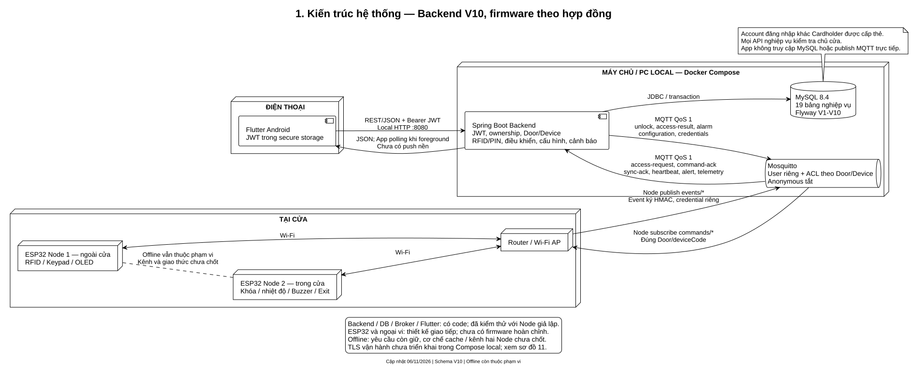

[Source](diagrams/01-system-overview.puml).

App dùng REST và JWT với Backend. Backend truy cập MySQL qua JDBC và trao đổi
MQTT với Broker. Mỗi Node dùng credential riêng, Broker giới hạn topic, Backend
kiểm tra thêm chữ ký và Door/Device/vai trò. App không truy cập DB hay MQTT
trực tiếp. Thông báo hiện là inbox bền vững và polling foreground, chưa có FCM.
Kênh trực tiếp giữa hai Node khi offline vẫn cần nhóm thiết kế.

<a id="diagram-02"></a>
## 2. Khối phần cứng hai Node

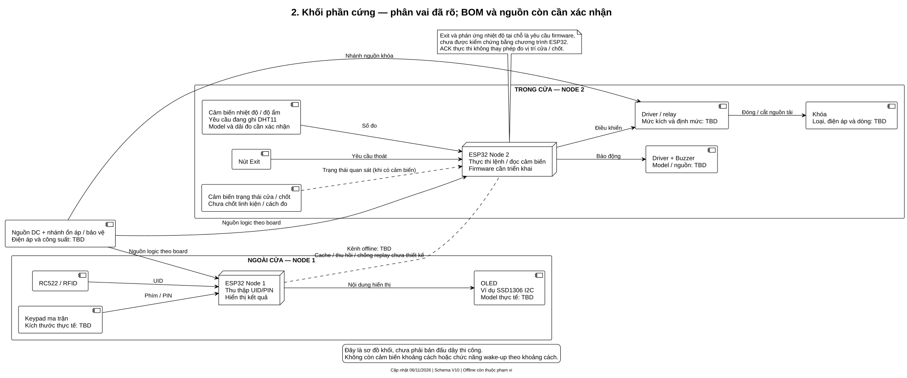

[Source](diagrams/02-hardware-blocks.puml).

Node 1 ở ngoài cửa: RC522, Keypad, OLED. Node 2 ở trong cửa: điều khiển khóa,
cảm biến nhiệt độ, Buzzer, Exit. Không còn cảm biến khoảng cách hoặc wake-up
theo khoảng cách. SSD1306 chỉ là ví dụ màn hình, chưa xác nhận model mua thật.
Model khóa/relay, nguồn và cách quan sát cửa/chốt cần được xác nhận trước sơ đồ
đấu dây. Dải đo cảm biến thực tế phải phù hợp ngưỡng nhiệt độ dự án chọn.

<a id="diagram-03"></a>
## 3. Mô hình miền và sở hữu

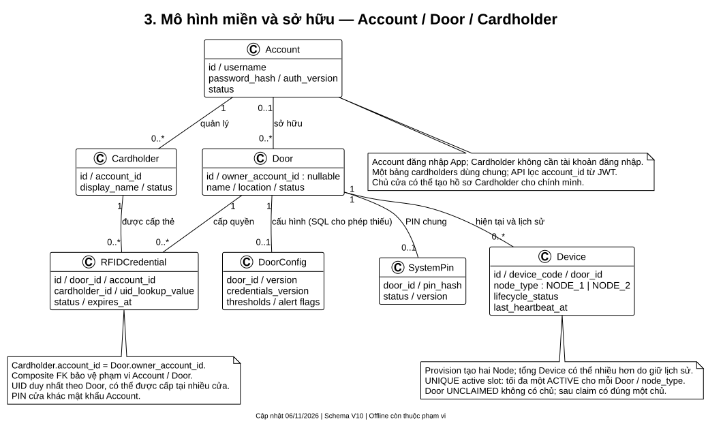

[Source](diagrams/03-domain-ownership.puml).

Account đăng nhập và sở hữu Door. Cardholder thuộc Account, không cần đăng
nhập; RFID liên kết Cardholder với một Door của cùng Account. Một bảng lưu
nhiều khách hàng nhưng API lọc theo Account từ JWT. Door chưa claim chưa có
chủ. Các Device cũ được giữ; chỉ tối đa một ACTIVE cho mỗi vai trò tại một Door.
Sơ đồ dùng bội số SQL, nên Door có thể chưa có PIN/config; provision và service
áp dụng các điều kiện nghiệp vụ chặt hơn trước khi kích hoạt.

<a id="diagram-04"></a>
## 4. Xác thực RFID/PIN online

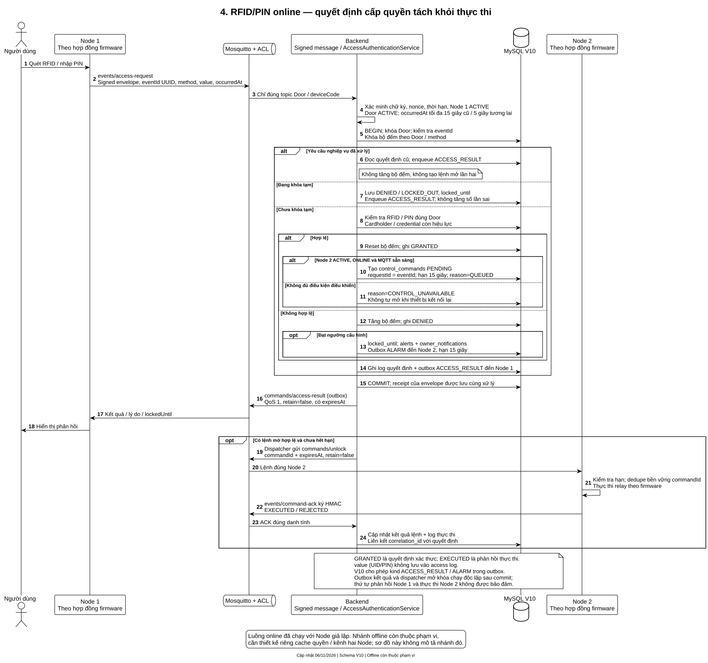

[Source](diagrams/04-rfid-pin-sequence.puml).

Backend xác minh envelope và vai trò Node 1, khóa Door/bộ đếm theo phương thức,
kiểm tra quyền thẻ/PIN và ghi quyết định. Đúng quyền được ghi `GRANTED`; nếu
Node 2 sẵn sàng thì tạo lệnh mở. `CONTROL_UNAVAILABLE` vẫn có thể đi kèm quyết
định hợp lệ, vì chưa thể điều khiển. Gửi trùng eventId không đếm sai hoặc mở
lần hai. Đạt ngưỡng sai tạo khóa tạm, cảnh báo, inbox và lệnh còi hết hạn.

Log quyết định và log thực thi được liên kết bằng correlationId. Không ghi
UID/PIN vào log. V10 sửa CHECK để outbox nhận `ACCESS_RESULT` và `ALARM`.
Offline còn thuộc phạm vi nhưng không được suy ra từ luồng online này.

<a id="diagram-05"></a>
## 5. Điều khiển cửa từ App

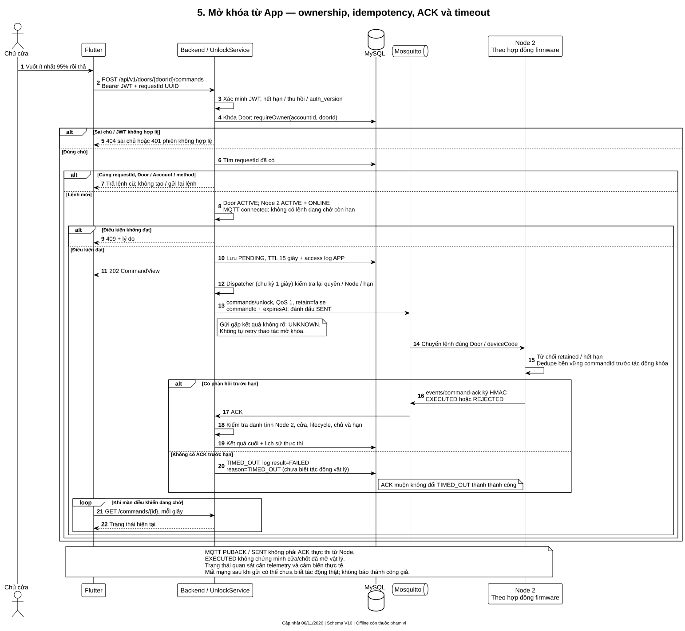

[Source](diagrams/05-app-control-sequence.puml).

`POST /api/v1/doors/{doorId}/commands` lấy Account từ JWT, kiểm tra chủ cửa,
Door ACTIVE, Node 2 ACTIVE/ONLINE và kết nối MQTT. UUID requestId giữ retry
nhất quán; tối đa một lệnh đang chờ còn hạn mỗi cửa. Lệnh có hạn 15 giây,
QoS 1, không retained. Lỗi giao kết quả chưa rõ dẫn đến `UNKNOWN`, không tự
gửi lại thao tác mở khóa. Không có ACK đúng hạn dẫn đến `TIMED_OUT`; ACK muộn
không đổi thành thành công. App thăm dò khi đang mở màn điều khiển.

`SENT`/MQTT PUBACK khác ACK thực thi; `EXECUTED` khác xác nhận vị trí vật lý.
Phép đo trạng thái cửa/chốt cần firmware và cảm biến thực tế phù hợp.

## 6. Cảnh báo và mất kết nối — tạm hoãn

Nhóm xác nhận giữ offline và yêu cầu chưa vẽ sơ đồ 6 trong đợt này. Không nhúng
hay đưa bản sơ đồ 6 cũ vào PR. Khi tiếp tục cần chốt kênh hai Node, dữ liệu
offline được phép dùng, thu hồi, chống replay, clock/reboot và xử lý hàng đợi
khi mạng trở lại; không tự phát lại lệnh mở khóa đã hết hạn.

<a id="diagram-07"></a>
## 7. ERD V10

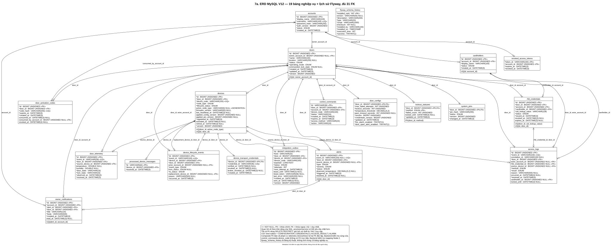

[Source đầy đủ](diagrams/07-database-erd.puml) ·
[Bản SVG để phóng to](diagrams/07-database-erd.svg) ·
[Bảng khóa và CHECK](diagrams/database-constraints-v10.md).

Bản đầy đủ được đối chiếu metadata MySQL V10 ngày 06/11/2026: **19 bảng nghiệp
vụ + `flyway_schema_history`, 31 FK**, kèm PK, unique, nullable và cột generated.
Metadata không chứa bản ghi khách hàng. Một số FK là composite để bảo vệ phạm
vi Door/Account/Device. `door_telemetry` có hai FK độc lập đến Door/Device;
Backend kiểm tra Device đúng Door và đúng Node 2. `control_commands.device_code`
không có FK trực tiếp; Backend đối chiếu Device trước khi gửi và nhận ACK.

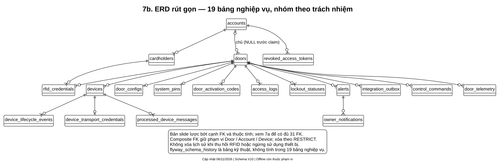

[Source rút gọn](diagrams/07-database-erd-slide.puml).

Bản slide bỏ thuộc tính và một số cạnh để dễ trình bày. Khi triển khai/review
DB, dùng bản đầy đủ, [đặc tả DB](database-erd.md) và SQL migration. V10 thay
CHECK của outbox, không thêm bảng/cột, giữ nguyên dữ liệu và V1–V9 đã áp dụng.
Các enum cũ như `AUTO_PROXIMITY` còn trong SQL để tương thích dữ liệu, không
khôi phục chức năng khoảng cách đã bỏ.

<a id="diagram-08"></a>
## 8. Provision, claim, đồng bộ và kích hoạt

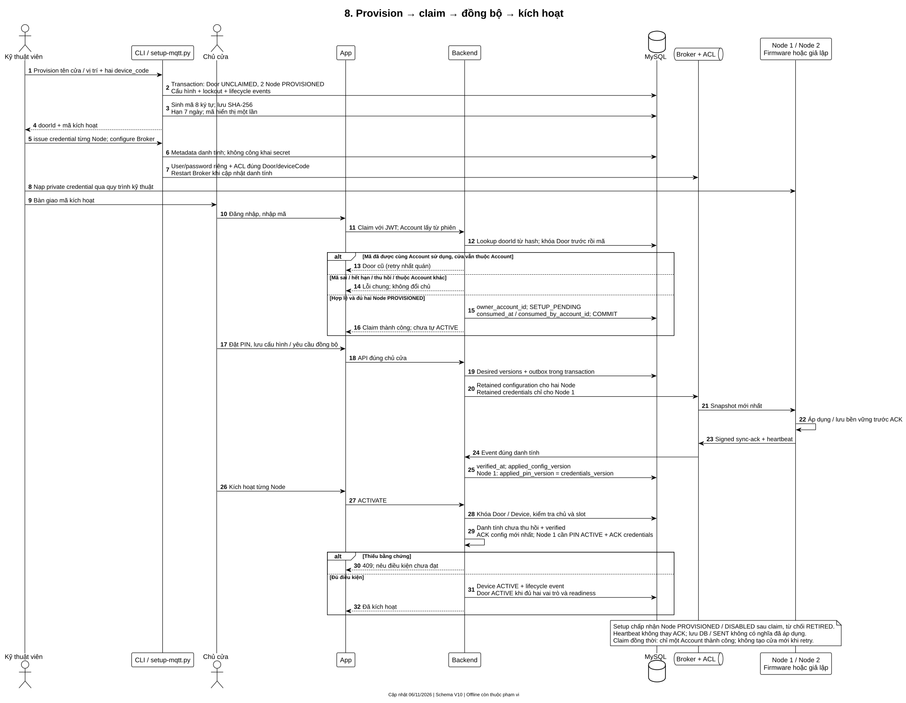

[Source](diagrams/08-provision-claim-sequence.puml).

CLI tạo Door và hai Node PROVISIONED, sinh mã 8 ký tự có hạn 7 ngày, chỉ lưu
SHA-256. Công cụ MQTT cấp danh tính riêng và cấu hình Broker ACL. Claim khóa
Door trước mã, kiểm tra lại sau khóa; cùng Account retry nhận Door cũ, Account
khác không chiếm được cửa. Claim không tự mở khóa hoặc tự ACTIVE.

Sau claim, cấu hình được gửi đến cả hai Node, credentials đến Node 1. Node
áp dụng rồi ACK; heartbeat không thay ACK. Kích hoạt cần danh tính đã verified,
chưa thu hồi và ACK config mới nhất; Node 1 thêm PIN ACTIVE cùng ACK credentials.
Setup được phép ở PROVISIONED/DISABLED sau claim để tránh vòng lặp kích hoạt.

<a id="diagram-09"></a>
## 9. Trạng thái thiết bị

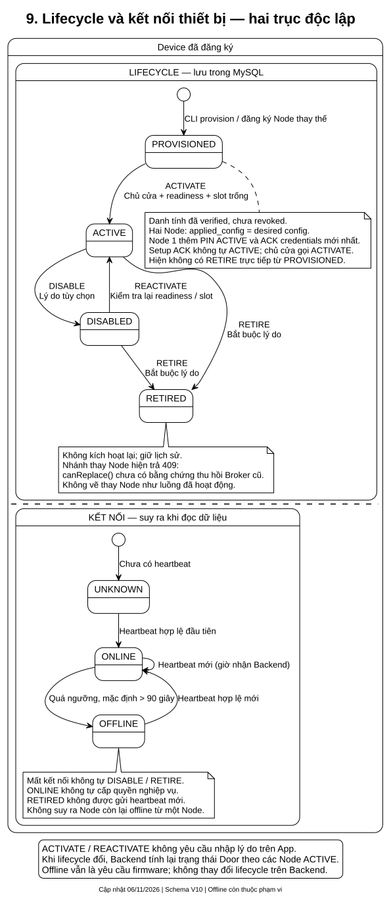

[Source](diagrams/09-device-state.puml).

Lifecycle lưu DB: PROVISIONED, ACTIVE, DISABLED, RETIRED. Trạng thái kết nối suy
ra riêng: UNKNOWN nếu chưa có heartbeat; ONLINE trong ngưỡng; OFFLINE khi quá
ngưỡng, mặc định hơn 90 giây. Không tự disable do mất mạng. Retire giữ lịch sử
và không kích hoạt lại. Thao tác activate/reactivate không bắt nhập lý do.

Backend có cấu trúc transaction cho thay Node, nhưng `canReplace()` vẫn trả
false khi chưa chứng minh thu hồi credential/session Broker của Node cũ. Nhánh
này hiện trả 409, không được trình bày như chức năng thay thiết bị đã nghiệm thu.

<a id="diagram-10"></a>
## 10. MQTT và quyền topic

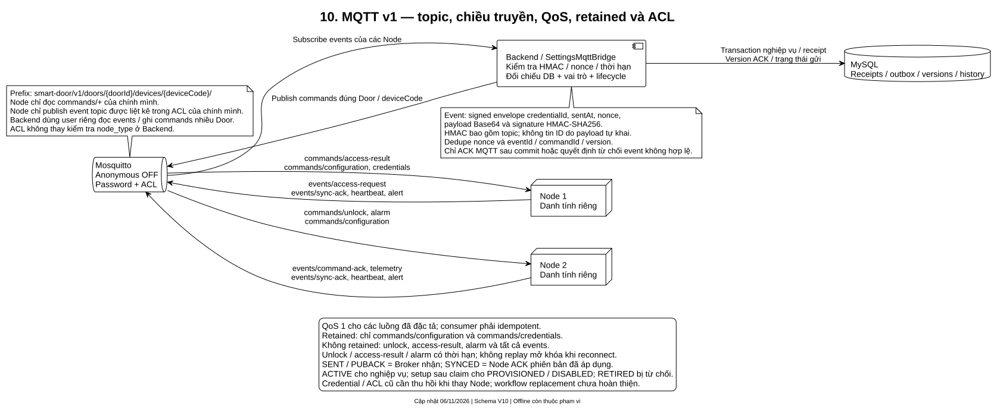

[Source](diagrams/10-mqtt-acl-flow.puml) ·
[Hợp đồng topic/payload](../../contracts/mqtt/topics.md).

Prefix chính thức là `smart-door/v1/doors/{doorId}/devices/{deviceCode}/`.
QoS 1, chỉ retained snapshot configuration/credentials. Unlock/access-result/
alarm và mọi event không retained. Broker giới hạn user theo topic; Backend
kiểm tra HMAC có bao gồm topic, nonce, thời hạn, mapping DB, lifecycle và vai trò.
Kiểm tra vai trò không được suy ra chỉ từ ACL. Backend xử lý receipt và nghiệp
vụ trước MQTT ACK; eventId/version/commandId giữ idempotency khi giao lặp.

Snapshot PIN/RFID đang tồn tại trong contract, nhưng chưa đủ chứng minh offline
đã hoạt động: firmware, cache an toàn, kênh hai Node và thu hồi vẫn cần thiết kế.

<a id="diagram-11"></a>
## 11. Triển khai local

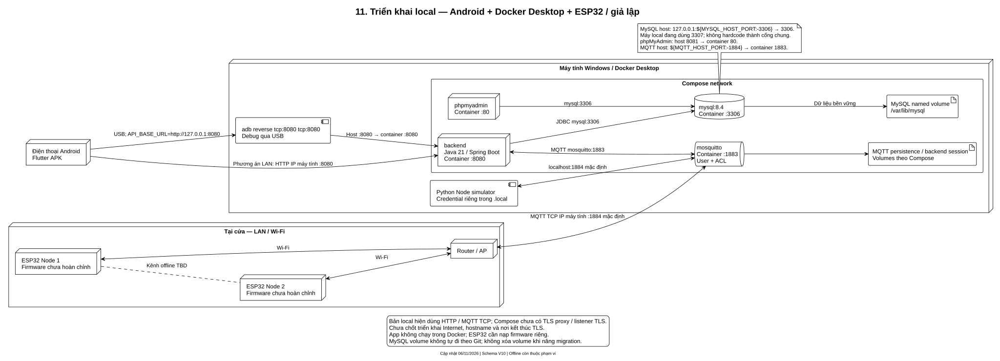

[Source](diagrams/11-deployment.puml).

Docker chạy Backend, MySQL, Mosquitto và phpMyAdmin. Backend host 8080,
phpMyAdmin 8081; MQTT host mặc định 1884 → container 1883; MySQL bind loopback
với cổng `MYSQL_HOST_PORT` (mặc định 3306, local hiện dùng 3307) → container 3306.
App Android debug qua USB dùng adb reverse, hoặc kết nối IP LAN máy tính.
Trên máy tính giả lập Node kết nối localhost:1884, không nhầm Broker Windows 1883.

Compose local dùng HTTP và MQTT TCP, chưa triển khai TLS proxy/listener TLS.
Triển khai Internet cần phương án riêng về TLS, hostname và ranh giới mạng.
Dữ liệu MySQL giữ trong volume, không tự được chia sẻ khi clone Git.

<a id="diagram-12"></a>
## 12. Khung đấu nối phần cứng

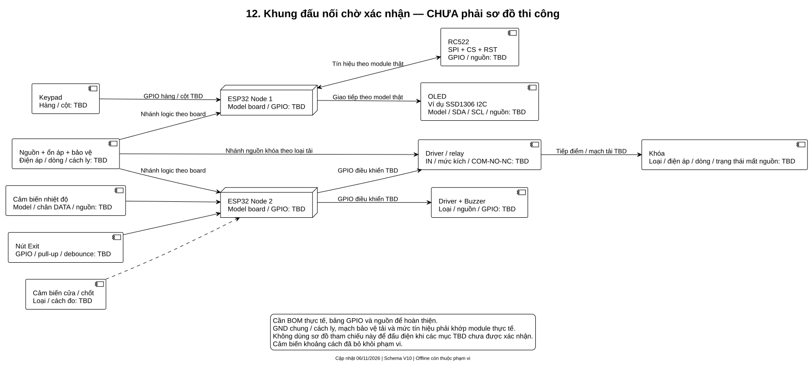

[Source](diagrams/12-hardware-wiring.puml).

Khung này ghi rõ ngoại vi nối vào Node nào; chưa điền GPIO/điện áp chưa được
nhóm xác nhận. Để thành bản thi công cần: model ESP32/OLED/keypad/cảm biến,
relay và khóa; nguồn, dòng tải, trạng thái khóa khi mất nguồn, mức kích, GPIO,
mass/cách ly, bảo vệ tải và cơ chế nhận biết cửa/chốt. Không dùng các chân
tham chiếu cũ như thông số đã nghiệm thu.

## Kiểm chứng và giới hạn bàn giao

Kiểm tra phần mềm ngày 06/11/2026 trước PR #21:

- Maven `verify`: **182 test đạt**, không fail/error/skip; đóng gói thành công.
- Flutter analyze không có vấn đề; **65 test đạt**.
- Python simulator: **7 test đạt**.
- MySQL local V10 audit đạt; hồi quy V9 → V10 trên schema riêng đạt, giữ dữ liệu
  cũ và các ràng buộc ngoài kind; 19 bảng nghiệp vụ, 31 FK.
- Smoke API/MQTT qua MySQL/Mosquitto thật đạt: RFID/PIN, ACK mở khóa, yêu cầu
  trùng, khóa tạm/còi, telemetry, inbox/cảnh báo và phân quyền chủ cửa.
- Đây là Node giả lập. Chưa nghiệm thu firmware, relay/khóa thật hoặc offline.

Kiểm tra sơ đồ trong đợt tài liệu: cú pháp PlantUML, sinh lại SVG, đối chiếu
metadata ERD, liên kết nội bộ và rà soát nhãn hiện trạng/TBD. Không cần chạy lại
toàn bộ test ứng dụng chỉ vì đổi tài liệu. Xem [hướng dẫn DB](database-setup.md)
và [test trên App](../06-frontend/access-monitoring.md) để tái hiện phần mềm.

Kết quả kiểm tra hồ sơ: 12 cặp source/SVG hợp lệ, sơ đồ 6 được loại khỏi đợt
phát hành; ERD hiển thị đủ 171 cột của 20 bảng (kể cả lịch sử Flyway), 31 cạnh
FK; 70 liên kết nội bộ và anchor được kiểm tra. Phụ lục có 18 CHECK cùng danh
sách PK/unique. Chỉ metadata cấu trúc được đưa vào tài liệu, không có dữ liệu
khách hàng, credential riêng hoặc backup DB.

Xuất ảnh bằng PlantUML 1.2025.2 (Java 21), ở thư mục gốc:

```powershell
$sources = Get-ChildItem docs/03-technical-reference/diagrams/*.puml |
    Where-Object { $_.Name -ne '06-alert-offline-flow.puml' }
java -jar <duong-dan-plantuml.jar> -charset UTF-8 -checkonly $sources.FullName
java -jar <duong-dan-plantuml.jar> -charset UTF-8 -tsvg $sources.FullName
```

Jar là công cụ local, không đưa vào Git. Không sửa SVG bằng tay; sửa `.puml`
rồi xuất lại theo [quy chuẩn PlantUML](../00-getting-started/03-plantuml-conventions.md).
