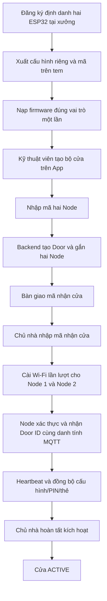

# Luồng kỹ thuật viên, bàn giao và cài Wi-Fi

Luồng bổ sung V14 cho một bo hỏng hoặc vị trí đã RETIRED nằm ở
[thay Node và phục hồi sau retire](node-replacement.md). Không tạo bộ cửa
hoặc claim mới để thay một bo; cần Backend/supervisor/Compose cùng bản V14.

Luồng này dùng chung App Android và chọn trang chính theo vai trò từ Backend.
Tài khoản TECHNICIAN mở trực tiếp **Kho ESP32 và tem thiết bị**, **Tạo bộ cửa**,
**Các bộ cửa đã tạo**. Nút Hồ sơ ở góc trên dùng xem tài khoản, đổi mật khẩu và
đăng xuất. Tài khoản khách hàng có dashboard, thêm/claim và quản lý cửa đã sở
hữu. Bạn có thể gõ hoặc dán mã vào các ô nhập trên App.

## Sơ đồ bàn giao và cài Wi-Fi

- [Bộ sơ đồ V13 và giải thích luồng](../03-technical-reference/system-design-review.md#diagram-08).
- [Sơ đồ đăng ký ESP32, tạo bộ cửa, claim và kích hoạt](../03-technical-reference/diagrams/08-provision-claim-sequence.svg).
- [Sơ đồ cài Wi-Fi từng ESP32 và nhận danh tính từ Backend](../03-technical-reference/diagrams/08b-wifi-enrollment-sequence.svg).
- [Cảnh báo và mất kết nối theo code](../03-technical-reference/system-design-review.md#diagram-06).
- [GPIO và đấu nối theo firmware](../03-technical-reference/hardware-wiring.md).

Đăng ký trên App tạo danh tính bo; xưởng nạp firmware/header riêng qua USB.
Kỹ thuật viên lắp đặt dùng bo đã chuẩn bị để tạo bộ cửa. Chủ nhà claim rồi
mới cài Wi-Fi từng bo; không cần nhập Wi-Fi hoặc Door ID trực tiếp vào DB.

## Đường đi



## Chuẩn bị môi trường

Docker Compose chạy Backend, MySQL và Broker. `.env` cần `DEVICE_BOOTSTRAP_URL`
là endpoint `/api/v1/device-enrollment` mà ESP32 truy cập được, `MQTT_PUBLIC_HOST`
và `MQTT_HOST_PORT`. Bản local đã chọn IP Ethernet `192.168.0.100` khi triển khai.
Nếu IP laptop/mạng thay đổi, cập nhật cấu hình trước khi chuẩn bị các board mới.
Khi lắp ngoài LAN, dùng địa chỉ máy chủ có thể truy cập tại nơi lắp đặt.

`TECHNICIAN_USERNAME` và `TECHNICIAN_PASSWORD` tạo tài khoản kỹ thuật viên đầu
tiên khi Backend chạy. Bản local đã sinh mật khẩu ngẫu nhiên trong `.env`.
Đọc mật khẩu tại file riêng đó để đăng nhập. Mật khẩu đã đổi qua App được giữ
nguyên ở các lần khởi động sau. Đăng ký công khai tạo CUSTOMER. Kỹ thuật viên
vẫn cần quyền sở hữu để dùng các API điều khiển cửa của khách hàng.

V13 thêm `accounts.role`, `device_inventory`, `installation_kits`. Các account
cũ giữ CUSTOMER. Database hiện có 21 bảng nghiệp vụ và 35 FK. Inventory ghi
người chuẩn bị, vai trò và liên kết Device duy nhất. Kit ghi người lắp đặt,
requestId và Door. Các migration V1–V12 được giữ nguyên.

Broker mới tự nhận manifest danh tính trên volume riêng, cập nhật password/ACL
và reload. Backend xuất manifest tối đa mỗi ba giây, Broker kiểm tra mỗi hai
giây. Khi tạo bộ cửa, App không cần chạy `setup-mqtt.py configure`. Manifest
chỉ chứa thông tin cần cho Broker, không chứa khóa ký HMAC. Khóa của từng Node
được cấp riêng qua enrollment có xác thực.

## Thao tác tại xưởng

1. Đăng nhập kỹ thuật viên, thao tác ngay tại **Kho ESP32 và tem thiết bị** trên trang chính.
2. Đăng ký một NODE_1 và một NODE_2. Mỗi mã ứng với một board vật lý.
3. Mở từng thiết bị, sao chép cấu hình nạp thành `enrollment_config.local.h`
   trong `firmware/node-auth/` hoặc `firmware/node-control/` đúng vai trò.
4. Nạp sketch tương ứng. File cấu hình có định danh/khóa riêng và địa chỉ
   enrollment. Door ID và Wi-Fi nhà sẽ được nhận trong các bước sau.
5. Lưu/in mã định danh và mã thiết lập lên tem. Bootstrap secret chỉ nằm
   trong file nạp riêng. Hai file `enrollment_config.local.h` được Git bỏ qua.

Việc chuẩn bị/nạp firmware thực hiện tại xưởng. Kỹ thuật viên lắp đặt thao tác
trên App với các board đã được chuẩn bị. Bản đầu dùng kho theo tài khoản kỹ
thuật viên, nên dùng cùng tài khoản chuẩn bị và tạo bộ cửa.

## Kỹ thuật viên tạo và bàn giao cửa

Nhập tên/vị trí và mã Node 1, Node 2, rồi bấm tạo bộ cửa. Backend
kiểm tra đúng vai trò, mã không trùng và chưa gắn cửa khác. Hai Node ở
PROVISIONED, Door UNCLAIMED. App hiển thị mã nhận cửa cùng nút sao chép.
Mã dùng một lần và hết hạn sau bảy ngày. Bộ đã tạo xuất hiện trong danh sách.
Nếu mất phản hồi/mã bàn giao, dùng **Cấp lại mã** trên bộ chưa claim, mã cũ sẽ
hết hiệu lực. Sau claim, phần kỹ thuật không xuất lại cấu hình nạp của bộ đó.

## Chủ nhà nhận và thiết lập

1. Đăng nhập khách hàng, chọn thêm cửa và nhập mã nhận cửa.
2. Mở chi tiết cửa → **Thiết lập Wi-Fi và kích hoạt**. App lấy thông tin thiết
   lập hai Node khi điện thoại còn có Internet/kết nối Backend.
3. Chọn Node 1. Bật nguồn hoặc giữ BOOT ba giây khi firmware đang chạy để
   Node phát Wi-Fi thiết lập. App hiển thị tên mạng và mật khẩu từ tem.
4. Bấm mở cài đặt Wi-Fi, kết nối mạng Node và chọn giữ kết nối khi Android báo
   không có Internet. Trở lại App, kiểm tra mã thiết lập đã điền sẵn hoặc
   nhập mã trên tem.
5. Chọn/nhập Wi-Fi nhà 2.4 GHz và mật khẩu, gửi đến Node. App kiểm tra đúng
   danh tính board. Node lưu NVS, kết nối Wi-Fi nhà và gọi enrollment Backend.
6. Lặp lại cho Node 2. Đưa điện thoại về mạng nhà rồi cập nhật trạng thái.
7. Đặt PIN, gửi cấu hình ở các màn hình được liên kết ngay trong thiết lập.
8. Đợi ACK hiện hành rồi bấm **Hoàn tất và kích hoạt bộ cửa**. Backend kiểm tra
   cả hai Node và kích hoạt trong cùng transaction. Thử thao tác truy cập cửa.

Để đổi Wi-Fi, giữ BOOT khi Node đang chạy và dùng lại màn hình cài Wi-Fi.
Firmware và các file cấu hình cũ theo Door ID/Wi-Fi vẫn được hỗ trợ. Bộ cũ
chưa có inventory/tem mới tiếp tục dùng cách cấu hình firmware hiện có.

## Kiểm thử và bàn giao

`OnboardingTests` kiểm tra phân quyền, retry tạo bộ, vai trò, claim trước
enrollment, thu hồi khóa và readiness trước hoàn tất. Flutter kiểm tra nhập
mã và luồng thêm cửa. `db-fresh-check.py` kiểm tra V1–V13 trên
schema riêng, gồm role mặc định cho account cũ và CHECK/FK của inventory.

Sau khi build/chạy Compose có V13, dùng Python đã cài `scripts/requirements.txt`:

```powershell
python scripts/onboarding-smoke.py
```

Smoke tạo account, hai board và Door thử, kiểm tra quyền, enrollment, tự đồng
bộ Broker và kích hoạt qua Node giả lập. Dữ liệu thử được giữ để đối chiếu,
private export/log nằm trong `.local/`. Không dùng kết quả simulator để nghiệm
thu Wi-Fi, camera hoặc phần cứng thật. Cần thử trọn luồng bằng hai ESP32 và
điện thoại Android, gồm mã sai, Wi-Fi sai và retry.

Firmware Node 1 có phím dự phòng giữ 1/xóa, giữ 2/nhập 0, giữ 3/gửi PIN.
Offline vẫn là phạm vi cần phát triển riêng. Mẫu local dùng MQTT TCP, NVS chưa
mã hóa flash. HTTPS enrollment cần `DEVICE_BOOTSTRAP_CA_PEM` và cấu hình thời
gian/chứng chỉ phù hợp. TLS cho transport MQTT và nghiệm thu bảo mật thiết bị
cần được hoàn thiện trước triển khai thực tế.

## Kết quả kiểm tra bản triển khai

- Backend đã qua 193 test hiện có và 5 test onboarding, gồm từ chối xuất cấu
  hình nạp sau claim và kiểm tra readiness thực tế trước kích hoạt.
- Flutter analyze sạch, 77 test đạt ở bản V13 ban đầu, gồm 5 ca trang chính theo
  vai trò, khôi phục phiên, đăng xuất, retry và chuyển tài khoản.
- Build APK debug đạt. Đã xử lý lỗi cache Kotlin khi thư viện Pub ở ổ C còn
  dự án ở ổ D bằng `kotlin.incremental=false`.
- Firmware factory/enrollment của cả hai Node build trên ESP32 core 3.3.11 đạt.
  Node 1 dùng khoảng 89% flash, Node 2 khoảng 86%. Chưa nạp bản mới vào board thật.
- MySQL V1–V13 kiểm tra trên schema riêng đạt. Đã backup DB local trước khi
  nâng, áp dụng V13 lên DB ứng dụng và chạy audit đạt với 35 FK.
- Smoke API/MQTT thật đạt với Door thử **13**, gồm phân quyền, retry, claim,
  enrollment, tự đồng bộ Broker, ACK và hoàn tất kích hoạt. Hai Node trong
  smoke là giả lập và đã dừng khi test kết thúc. Dữ liệu thử được giữ trong DB.
- Backend/Broker local đang chạy bản có onboarding. Health endpoint hoạt động.
  Địa chỉ server LAN được chọn là `192.168.0.100`, thông tin đăng nhập kỹ thuật
  viên nằm trong `.env` riêng. Khi triển khai, dùng cùng phiên bản code,
  migration V13 và tài liệu onboarding trong PR.

Log riêng gồm `.local/onboarding-smoke.log`, `.local/onboarding-migrations.log`,
`.local/onboarding-db-after.log`, `backend/target/onboarding-tests-final.log`,
`mobile/analyze-onboarding.log` và `mobile/build-onboarding-final.log`.

Bước nghiệm thu còn lại là kết nối SoftAP, lưu/đổi Wi-Fi và
kích hoạt bằng hai board thật. Android dùng Wi-Fi transport trực tiếp cho các
request setup, nên điện thoại có thể giữ đường Internet khác trong lúc cài Node.
Mật khẩu Wi-Fi đi qua kênh local đó và được giữ ở NVS của ESP32.

## Test thủ công trên App khi chưa có ESP32

Ảnh giao diện nhập mã nằm tại
[trang kỹ thuật viên](../06-frontend/images/technician-home-v13.png) và
[màn hình cài Wi-Fi](../06-frontend/images/node-wifi-setup-v13.png).
Ảnh render từ widget thật với dữ liệu tổng hợp; không phải bằng chứng đã
kết nối SoftAP trên điện thoại hoặc chạy phần cứng thật.

Tạo bộ cửa thử mới. Chạy từ root repo, giữ Terminal Flutter và hai Terminal
Node giả lập riêng. Chuẩn bị Python trong môi trường riêng:

```powershell
python -m venv .local/test-tools
.\.local\test-tools\Scripts\python.exe -m pip install -r scripts/requirements.txt
```

1. Mở Docker Desktop và chạy `docker compose up -d --build`. Health tại
   `http://localhost:8080/actuator/health` phải UP. Chạy `mobile/tool/run-usb.ps1`
   để đưa App mới lên điện thoại Android đã cho phép USB debugging.
2. Đăng nhập TECHNICIAN bằng thông tin trong `.env`. Tại **Kho ESP32 và tem
   thiết bị** trên trang chính, đăng ký một NODE_1 và một NODE_2. Ghi hai unitCode.
3. Trước khi claim, tải cấu hình từng Node về PC. Thay `MA_NODE_1/2` bằng mã
   thực tế. Lệnh dùng tài khoản kỹ thuật viên trong `.env`, nên mật khẩu ở đó
   phải là mật khẩu đăng nhập hiện hành.

   Nếu cần nhập mật khẩu hiện hành trực tiếp, thêm `--ask-password` vào lệnh.
   Terminal sẽ hỏi mật khẩu và che nội dung khi nhập. Có thể chọn tài khoản
   bằng `--username technician`. `--prepare-unit` nhận giá trị `UNIT_CODE`
   dạng UUID, ví dụ `11111111-1111-4111-8111-111111111111`.
   `SETUP_CODE` 16 ký tự được dùng ở bước cài Wi-Fi.

```powershell
.\.local\test-tools\Scripts\python.exe scripts/simulate-enrolled-node.py --prepare-unit "MA_NODE_1"
.\.local\test-tools\Scripts\python.exe scripts/simulate-enrolled-node.py --prepare-unit "MA_NODE_2"
```

4. Trên App tạo bộ cửa bằng hai mã, lưu mã claim. Thử mã Node sai vai trò,
   mã trùng và mã không tồn tại, mỗi trường hợp phải bị từ chối. Tạo đúng phải
   thấy Door UNCLAIMED và hai Node PROVISIONED.
5. Đăng xuất kỹ thuật viên, đăng ký/đăng nhập khách hàng rồi nhận cửa bằng mã.
   Door chuyển SETUP_PENDING. Bấm hoàn tất khi chưa có ACK phải báo chưa đủ
   điều kiện. Kết nối từng Node ban đầu là UNKNOWN.
6. Đặt PIN và gửi cấu hình trên màn hình Thiết lập Wi-Fi và kích hoạt. Trước
   khi có simulator, trạng thái đồng bộ còn chờ. Màn hình cài Wi-Fi có thể mở,
   nhưng việc tìm mạng/lưu Wi-Fi thật cần board phát access point.
7. Mở hai Terminal PC, chạy một Node mỗi Terminal. Thay mã trong tên file
   bằng unitCode thực tế hoặc dùng đường dẫn mà bước chuẩn bị đã in ra.

```powershell
.\.local\test-tools\Scripts\python.exe scripts/simulate-enrolled-node.py ".local/onboarding-headers/MA_NODE_1.local.h" --duration 600
```

```powershell
.\.local\test-tools\Scripts\python.exe scripts/simulate-enrolled-node.py ".local/onboarding-headers/MA_NODE_2.local.h" --duration 600
```

8. Chờ Connected, quay lại App và gửi lại đồng bộ nếu cần. Hai Node phải ONLINE,
   ACK cấu hình khớp hiện hành và Node 1 có ACK PIN/thẻ. Bấm hoàn tất để cả hai
   ACTIVE và Door ACTIVE. Thử mở/đóng từ App, kết quả do Node 2 giả lập ACK.
9. Đổi PIN/cấu hình, gửi lại và theo dõi phiên bản được ACK. Dừng một simulator
   bằng Ctrl+C, chờ quá ngưỡng mặc định 90 giây rồi cập nhật App để thấy riêng
   Node đó OFFLINE. Chạy lại cùng lệnh sẽ phục hồi heartbeat. Thời gian 600 là
   10 phút, có thể tăng khi cần thử lâu hơn.
10. Dùng tài khoản khách hàng khác kiểm tra cửa thử không xuất hiện. Thử claim
    lại cùng mã bằng tài khoản khác phải bị từ chối. Thử dán mã từ nút sao
    chép trên màn hình bàn giao và kiểm tra mã sai bị từ chối.

Các lệnh simulator xác thực qua enrollment API và dùng danh tính đã được cấp
cho chính hai Node đó. Không xoay khóa hay sửa DB. File header phải được xuất
trước claim, vì sau bàn giao API chặn xuất lại cấu hình nạp. Nếu quên, tạo bộ
thử mới và xuất cấu hình trước khi claim. Không dùng `issue` để giải quyết lỗi này.

Script smoke tự động vẫn có thể chạy riêng để kiểm tra API/MQTT với bộ dữ liệu
khác. Hai ESP32 thật cần cho nghiệm thu SoftAP, mật khẩu Wi-Fi, NVS qua reset,
RFID/keypad, cảm biến, servo và offline.
